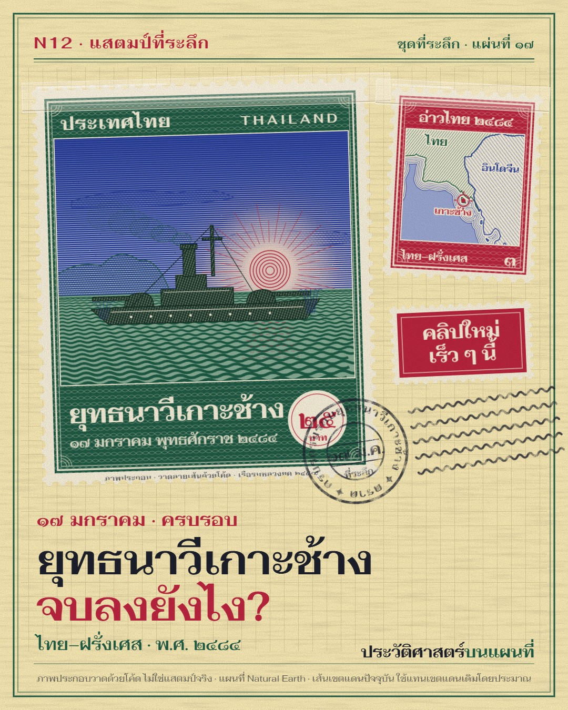

# N12 แสตมป์ที่ระลึก · Commemorative Stamp Album

**Fits:** commemoration days, anniversaries, "new clip coming" announcements, episode covers for a Facebook page ·
**Formats:** 4:5 (1080×1350, composition `Style-N12-post`) · **Code:** `Demo.tsx` + `kit/Stamp.tsx`

## Look

The post is a page from a stamp collector's album with a commemorative issue mounted on it. A pale butter-cream
album page with a faint quadrille grid and a thick + thin green ruled border; a page heading (kicker left in
carmine, sheet name right in green) over a double rule. The post's picture is a **large perforated stamp**
(640×760, tilted −1.6°): round perforation teeth, a paper margin, a solid deep-green frame with a fine guilloche
and corner rosettes, lettering reversed out in paper colour ("ประเทศไทย / THAILAND", the title, the date), a
denomination in a paper roundel with carmine numerals. Inside the frame the scene is **engraved**: only lines,
tone from line weight and spacing — a sky of ruled ultramarine lines that thin toward a carmine sun of concentric
rings and rays, wave-lines in deep green over a pale green underprint, a cross-hatched warship, hatched island and
smoke. A **smaller carmine stamp** carries the map (coast drawn as engraved water-lines, land hatched, the place
marked with a carmine ring), a **perforated carmine label** is the "coming soon" chip, clear **glassine mount
strips** hold the stamps, and a **round postmark** with the date ring and five wavy cancel lines strikes the
corner of the big stamp. Below, a printed caption: date line in carmine, a two-line headline (the question in
carmine), a green sub line, page name and a small credits line.

| Role | Hex |
|---|---|
| Album page | `#f3e6b4` (grid `#a8946a`, stamp paper `#f4eedd`) |
| Main ink: frame, sea, sub line | `#1f5a45` deep green |
| Second ink: sky, map sea, "อินโดจีน" side | `#22389a` ultramarine (underprint tint `#9eacd6`) |
| Accent: sun, map stamp, label, question, date | `#b8243f` carmine |
| Text, postmark | `#1c1f2b` |

**Type:** Fahkwang 400/600/700 (a flared, engraved-looking Thai display face). Headline 78 px 700, date line
34 px, sub 32 px 600, page heading 30 px, stamp title 50 px, denomination 50 px, label 36 px, credits 17 px — at
1080 wide. Thai numerals on the stamps and postmark.
**Line:** engraved hatch only inside the stamps (0.4–3.6 px ruled lines, 35°/−40° hatch, cross-hatch for dark
masses); 3 + 1 px frame rules; postmark 5/3 px with patchy ink; no flat colour areas inside the picture except the
pale underprint tints.

## Motion signature (slide-stack)

A post is a still; the demo shows how it animates as a video cover or a 5–10 s teaser:

- The page heading fades in; the big stamp slides up from below and straightens (spring, damping 15), the map
  stamp slides in from the right with a 10° twist, then the carmine label — each ~12 frames apart.
- Glassine mounts slide down over the stamps (frame 44).
- The postmark strikes at frame 62: scale 1.35 → 1 in 6 frames with a `pop`, ink appears patchy.
- The caption lines rise 26 px one after another (76, 84, 92), then the page name and credits.
- Inside the big stamp the engraving lives: wave-lines drift, smoke puffs drift aft, the ship bobs 2 px, shell
  splashes rise as engraved fountains, the sun's path flickers on the water. No cuts, no camera moves.

## Scenes in the kit (`kit/Stamp.tsx`)

| Component | Shows | Props |
|---|---|---|
| `AlbumPage` | The 4:5 album page (grid, border, fibre, grain) as one 1080×1350 SVG, centred in any frame | `children, html` |
| `PageHead` | Kicker left, sheet name right, double rule | `kicker, right, k` |
| `Stamp` | Perforated stamp paper laid on the page, slides in with `k` | `id, cx, cy, w, h, rot, k, from, tilt, teeth, pitch, children` |
| `EngravedFrame` | Double frame line with corner rosettes | `x, y, w, h, color` |
| `PictureWindow` | The picture area; `photo` = file in `public/` printed as a one-ink line-screen, else engraved SVG children | `id, x, y, w, h, photo, ink, children` |
| `EngravedMap` | Coast as water-lines, hatched land, marked place, labels | `w, h, extent, areas, mark, labels` |
| `Postmark` | Round cancel with date ring + wavy lines, strikes with `k` | `cx, cy, r, ring, date, year, waves, waveLen, rot, k` |
| `Mount` | Glassine mount strip | `cx, y, w, h, rot, k` |
| `Label` | Perforated carmine label (the chip) | `id, cx, cy, w, h, rot, k, lines` |
| `Caption`, `Footer` | Printed caption block; page name + credits | `x, y, date, lines, ask, sub, k` / `brand, credit, k` |
| `usePostBox`, `useIn` | Card geometry; entrance spring | — |

Hatch patterns available inside the page: `n12hatchG` (green 35°), `n12hatchB` (ultramarine −40°), `n12cross`
(dark cross-hatch), `n12guilloche`; filters `n12ink` (ink spread), `n12cancel`, `n12grain`.

## Build notes

The demo is registered as `Style-N12-post` (1080×1350). For a real post, copy the demo into your episode folder,
change the text, the engraved picture (or pass `photo`) and the map extent, and render one frame:
`npx remotion still Style-N12-post out/post.jpg --frame=200`. Draw the picture as line work only: build tone with
line weight/spacing and the hatch patterns, keep fills to the two pale underprint tints. Keep the headline to
2 lines + the carmine question, 8–12 words. The stamp must say it is an illustration (the imprint line in the
bottom margin and "ไม่ใช่แสตมป์จริง" in the credits) — never imitate a real issued stamp design. Caption order:
date line, 2–3 short paragraphs (context, the question, "คลิปใหม่ เร็ว ๆ นี้" + follow), picture and map credits,
6–8 hashtags.

## Data

No rasters. The map stamp is drawn from Natural Earth 1:50m countries (`world-atlas`, bundled with the template).
Modern borders used for old ones must say "เส้นเขตแดนโดยประมาณ".

## Don'ts

- No AI pictures; a real photo in `PictureWindow` only if the page owns it or it is public domain, credited.
- Never copy a real stamp (its design, value, country emblem layout) — this is an invented commemorative design.
- No flat colour fills or gradients inside the engraved picture (except the pale underprint); no glow effects.
- At most three inks (green, ultramarine, carmine) plus the dark postmark ink.
- Do not shrink the headline below 70 px; the post must read at feed-thumbnail size.

## Credits

Borders Natural Earth (public domain). The stamps, warship and postmark are drawn in code. Sound (teaser only):
template `SFX.swell`, `SFX.whoosh`, `SFX.pop`. Font: Fahkwang (SIL Open Font License).
