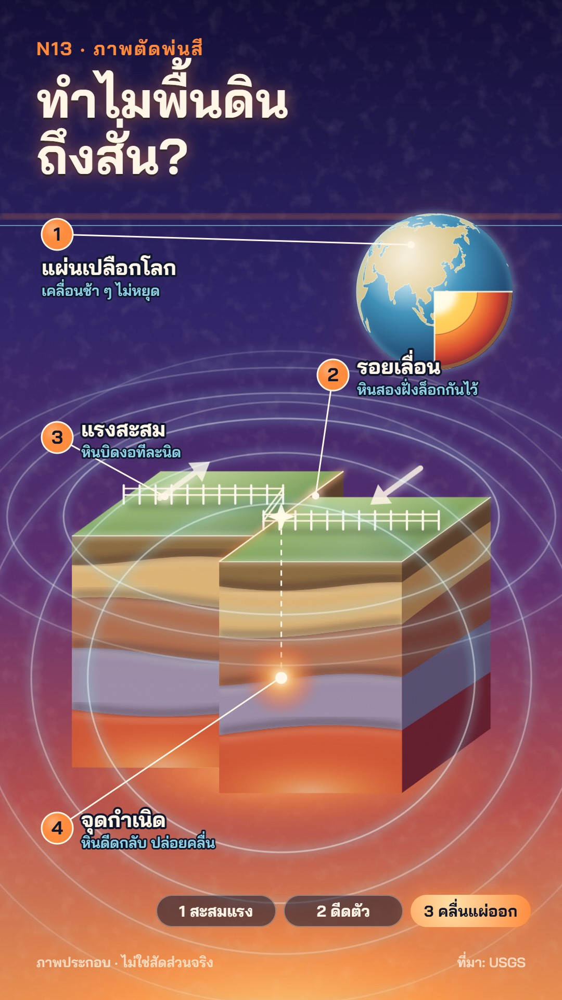

# N13 ภาพตัดพ่นสี · Airbrush Cutaway

**Fits:** science explainers, "why does X happen", how things work inside (Earth, volcano, engine, body) ·
**Formats:** 9:16 · **Code:** `Demo.tsx` + `kit/Cutaway.tsx`

## Look

A science poster painted with an airbrush. The ground is a smooth night-to-ember gradient (deep indigo at the top,
plum in the middle, a glowing orange at the bottom) with soft overspray specks and fine grain. The subject is cut
open: a block of crust in oblique projection with sprayed strata, a globe with a wedge removed to show crust,
mantle and core. Nothing has a hard ink outline; form comes from gradients, soft shadows under every layer line and
a bright rim light along the front-top edges. Heat and energy are glows. Numbered callouts (orange discs, thin
leader lines, bold clean labels with a dark stroke) name the parts.

| Role | Hex |
|---|---|
| Ground top → middle → bottom | `#140f36` → `#5e2f6e` → `#f0a05a` |
| Rock strata | `#8d6a3e` `#e3b878` `#b46f4f` `#9c8ea8` `#d35a3a` |
| Glow, callout discs | `#ff8a3d` |
| Cool highlight, waves, sub-labels | `#8fd3e8` |
| Labels | `#fff6e8` on stroke `#10162b` |

**Type:** Bai Jamjuree 700 (titles 96 px, labels 40 px), 600 for sub-labels 28 px, kicker 36 px orange with letter
spacing. **Line:** no outlines. The only lines are callout leaders (3 px cream) and seismic rings (3 px core +
22 px blurred halo).

## Motion signature

- **Spray reveal:** the main cutaway appears through a soft-edged mask that sweeps left to right like one airbrush
  pass (~40 frames).
- Slow push (+5 %) over the whole scene; the globe turns slowly.
- Callouts draw their leader line first, then the number disc and label fade in; one SFX `pop` per callout.
- The event (here the snap): `riser` into it, a 14-frame warm flash, 14 px shake, back-eased slip of the two
  blocks, then soft rings spreading from the focus and the epicentre; a `thunder_rumble` hit on the same frame.
- A process strip of three pills at the bottom; the active step glows.

## Scenes in the kit (`kit/Cutaway.tsx`)

| Component | Shows | Props |
|---|---|---|
| `PosterDefs`, `PosterGround`, `Grain` | Gradients, glow / grain filters, the poster ground | `w, h, glow` |
| `oblique` | Oblique projection `(x, z, depth) → screen` for block diagrams | `cx, top, kx, ky` |
| `BlockHalf` | One cut-open half of a crust block (front strata, top ground, side face), shifted along z | `P, x0, x1, D, H, t, heat` |
| `Fence` | A fence across the top face whose posts follow `zAt(x)` (shows strain and offset) | `P, x0, x1, zAt` |
| `Globe` | Orthographic Earth (Natural Earth land) with a wedge cut to show the core | `cx, cy, r, rot, k` |
| `Callout` | Numbered callout: dot, leader, disc, title + sub-label (`below` puts text under the disc) | `n, at, to, title, sub, k` |
| `Waves` | Airbrushed rings spreading from a point | `x, y, age, n, squash` |

New subjects: build them the same way — stacked bands with a gradient each, a blurred dark line under every
boundary and a blurred light line just below it, a rim light on the edges facing the viewer, glows for energy.

## Build notes

One SVG at 1080×1920; titles and the step strip are HTML on top. Blur filters are the cost: keep blurred shapes to a
few dozen per frame. The grain is one `feTurbulence` rect over everything (overlay blend). `Globe` uses
`world-atlas/land-110m.json` (bundled with the template).

## Data

Land outlines on the globe: Natural Earth 1:110m land via the `world-atlas` npm package (public domain), already in
the template — no fetch needed. Credit line for the description: "แผนที่โลก: Natural Earth (public domain)".

## Facts in the demo

Elastic rebound — rock on both sides of a locked fault bends as plates move, then slips suddenly and releases
seismic waves from the focus (hypocentre); the point above it is the epicentre. Source: USGS Earthquake Hazards
Program, "The Science of Earthquakes" and the USGS Earthquake Glossary ("elastic rebound", "hypocenter").
The block, strata and slip size are illustrative — labelled "ภาพประกอบ · ไม่ใช่สัดส่วนจริง" on screen.

## Don'ts

- No ink outlines, no flat fills without a gradient, no clip-art icons.
- Don't turn it into a dark dashboard (no glass cards, no UI chrome): the frame is a poster.
- Not for real maps or exact data; label every cutaway as illustration and say when the scale is not real.
- Don't copy a textbook or a published poster's figure; compose your own cross-section.

## Credits

All pictures drawn in code. Sound: template `SFX.swell`, `SFX.whoosh`, `SFX.pop`, `SFX.riser`, `SFX.hit`; house
library `thunder_rumble` (`npm run sfx-lib`). Font: Bai Jamjuree (SIL Open Font License). Globe land: Natural
Earth (public domain).
