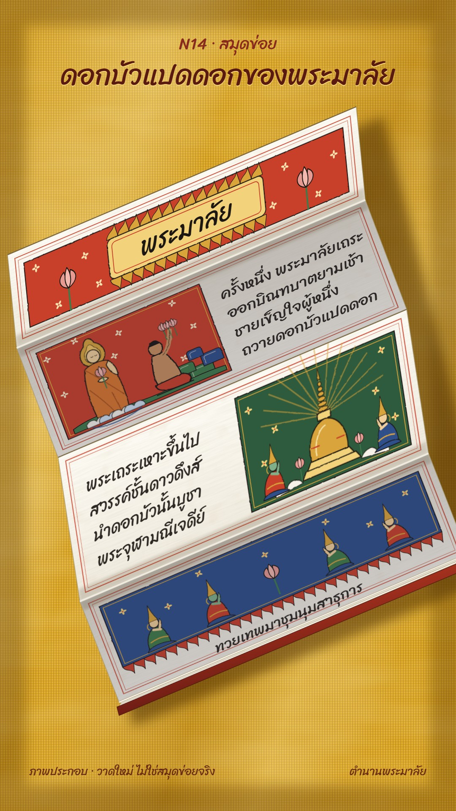

# N14 สมุดข่อย · White Samut Khoi Folding Book

**Fits:** Thai legends, Buddhist tales, old texts and chronicles, "what the old book says" episodes ·
**Formats:** 9:16 · **Code:** `Demo.tsx` + `kit/Khoi.tsx`

## Look

A white khoi-paper folding book (สมุดข่อยขาว) lies diagonally on golden temple silk. The accordion is seen at an
angle: every leaf is a parallelogram, leaves alternate between tilted toward the light (tall, bright) and tilted
away (foreshortened, in shade), so the side edge zigzags and every fold reads — dark valley creases, bright ridge
bends with the paper thickness bulging at the ends. The unopened leaves stay as a folded stack on a red lacquered
cover board. Each leaf has a double red rule, paper fibres and faint foxing. Paintings are polychrome mineral
colours (vermilion, verdigris green, indigo, ochre/gold, lotus pink) on painted grounds with sprig flowers, every
shape outlined in black ink with a slightly wobbly painted edge. Text is hand-written ink lines.

| Role | Hex |
|---|---|
| Silk ground | `#d9a521` (weave `#e2b23a` / `#b8861a`) |
| Khoi paper lit → shaded | `#fdfbf4` → `#e6e0d2` |
| Vermilion, gold/ochre | `#c8402a`, `#d9a43a` |
| Green, indigo, lotus | `#3f7a4a`, `#2f4f8a`, `#e79a92` |
| Ink, page titles | `#1c1712`, `#5a1a10` |

**Type:** Sriracha 400 — page text 42 px at leaf scale, cartouche title 64 px, screen title 66 px maroon with a
gold underglow, kicker 38 px. **Line:** black ink outline 2.4 px on every painted shape, roughened by a
displacement filter (`n14-paint`) so it looks brushed, not vector.

## Motion signature

- **Leaf-by-leaf unfold:** each leaf swings open on its fold over ~30 frames (height eases in, perspective inset
  relaxes, shade lifts); the folded stack shrinks by a few leaves each time. One soft `whoosh` per leaf.
- After a leaf lands, its ink lines **write themselves** left to right, one line after another (`tick` per page).
- Painted figures breathe very slightly (±3 px); the chedi's rays shimmer. No camera cuts — the book stays put, a
  slow 4 % push.

## Scenes in the kit (`kit/Khoi.tsx`)

| Component | Shows | Props |
|---|---|---|
| `KhoiDefs`, `Cloth` | Weave, dye, fibre, foxing, brushed-edge filters; the silk ground | `w, h` |
| `Accordion` | The book at an angle: leaves `{h, open, content}` drawn as affine parallelograms, folds, stack, cover | `x0, y0, w, angle, leaves, left, away, kink` |
| `Rules` | Double red border of a leaf | `w, h` |
| `InkLines` | Hand-written lines that write themselves | `x, y, lines, size, lead, k` |
| `Flames`, `Sprigs`, `Rocks`, `Lotus` | Flame scallops, scattered flowers, stylised rocks (เขามอ), lotus | position / size |
| `Monk`, `Offerer`, `Chedi`, `Deva` | Phra Malai, the poor man with lotuses, the Chulamani chedi, a kneeling deva | `x, y, s` + pose |

Draw leaf content in leaf coordinates (0…940 × 0…h); `Accordion` maps it onto the tilted leaf. Typical leaf: a
painted panel on one side, 4 ink lines on the other, alternating sides from leaf to leaf (like real Phra Malai
books, which put text between paintings).

## Build notes

One SVG at 1080×1920; the book group is rotated −14° and pushed slowly. Leaves are clipped to their parallelogram,
so content may overrun the leaf edge. Keep at most ~5 leaves open on screen; the displacement filter on figures
costs time, so apply it per figure, not per leaf.

## Facts in the demo

Story retold in our own words (not copied from any manuscript): the monk Phra Malai receives eight lotus flowers
from a poor man and takes them to the Chulamani chedi in Tavatimsa heaven, where the devas gather. Phra Malai is
one of the stories most often illustrated in Thai white samut khoi of the 18th–19th centuries. Background reading: Bonnie
Pacala Brereton, *Thai Tellings of Phra Malai* (1995); Henry Ginsburg, *Thai Manuscript Painting* (British Library,
1989). On screen: "ภาพประกอบ · วาดใหม่ ไม่ใช่สมุดข่อยจริง".

## Don'ts

- No black ground and no gold-on-black (that is N10 lacquer); no palm-leaf strips with string holes (that is M03).
- Don't trace paintings from real manuscripts or museum photos; draw new scenes in this manner.
- Don't flatten the folds: leaves must alternate light/shade and keep the zigzag edge.
- Text lines are short (4 per leaf); long passages go in the voice-over.

## Credits

All pictures drawn in code. Sound: house library `gong`, template `SFX.whoosh`, `SFX.tick`. Font: Sriracha (SIL Open
Font License).
