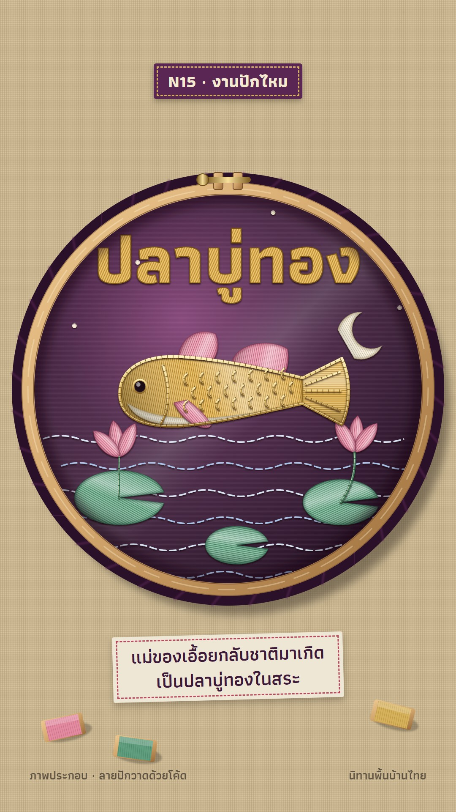

# N15 งานปักไหม · Silk Embroidery

**Fits:** folk tales, royal costume and textiles, culture and craft stories, festivals ·
**Formats:** 9:16 · **Code:** `Demo.tsx` + `kit/Silk.tsx`

## Look

The scene is embroidered on plum silk stretched in a round wooden hoop (brass screw clamp at the top) that lies on
unbleached flax linen beside spools of floss. Inside the hoop the silk has a soft diagonal sheen and darkens where the ring
grips it. Fills are **satin stitch**: parallel floss at a chosen angle per shape, each thread with a light and a
dark edge, a sheen band running across the thread direction, a padded edge shadow and a drop shadow so the
stitching sits raised on the silk. Outlines, gills and scales are **couched gold thread** (a gold cord with tiny
tie stitches). Water is **running stitch** in silver-blue; stars and eyes are **French knots**. The title inside the
hoop is gold satin.

| Role | Hex |
|---|---|
| Linen (outside the hoop) | `#c9b58f` |
| Silk centre → edge | `#7a3a6e` → `#3d1a3a` → `#1f0a1e` |
| Gold floss / gold cord | `#d9a441` / `#d8b25a` |
| Jade, peony, ivory floss | `#5f9e7e`, `#e58aa0`, `#f4ead2` |
| Hoop wood | `#d2a56c` |

**Type:** Athiti 700 — stitched title 150 px (satin-filled), kicker 40 px on a sewn label, caption 44 px on a
stitched linen tag, footer 28 px. **Line:** couched gold 4–6 px with dark ties every 12 px; running stitch dashes
14/8.

## Motion signature

- **Stitch-in:** every shape sews itself in — the satin advances across its threads (`k` 0→1) while the needle
  rides the leading edge, swinging across, its thread trailing to the hoop edge in the colour being stitched.
- Order follows how embroidery is worked: background running stitch → large satin fills → details → couched
  outlines → knots → title last.
- A soft `tick` every 10 frames while stitching (needle through silk); `hit` when the title finishes.
- No camera movement: the hoop is still; only the needle moves.

## Scenes in the kit (`kit/Silk.tsx`)

| Component | Shows | Props |
|---|---|---|
| `SilkDefs`, `Hoop` | Linen, silk sheen, raise/grain filters; hoop with silk, children clipped to the silk | `cx, cy, r` |
| `Satin` | A satin-stitched shape that sews in | `id, d, color, light, dark, angle, k, box` |
| `needleAt`, `Needle` | Needle position on a Satin's leading edge; the needle with its thread | `box, angle, k, frame` |
| `Couched` | Couched gold (or any) cord laid along a path | `id, d, k, len, w` |
| `Running` | Running stitch along a path | `id, d, k, len, color` |
| `Knot` | French knot | `x, y, r, color` |
| `Spool` | Floss spool on the linen | `x, y, color, rot` |

The demo draws its scene for a 430 px hoop centred at (540, 1000) and scales it into the hoop — keep that
convention for new scenes. Give every satin shape its own thread angle (follow the form: across a fish body, along
a petal, radial on a leaf).

## Build notes

Each `Satin` defines its own pattern, gradient and clips (ids must be unique). ~20 satin shapes and ~30 couched
paths render fine; the drop-shadow filter is per shape. The needle swings with `sin(frame·0.9)` — on stills it can
sit anywhere along the edge.

## Facts in the demo

ปลาบู่ทอง is a well-known Thai folk tale: the mother of the girl เอื้อย is reborn as a golden goby fish and comes when
her daughter calls at the water. Told as a folk tale (no historical claim); labelled "ภาพประกอบ · ลายปักวาดด้วยโค้ด"
and "นิทานพื้นบ้านไทย" on screen. The embroidery is drawn in code — no photo of real embroidery is used.

## Don'ts

- Not felt, not cross-stitch pixels, not quilting: fills are smooth satin floss with sheen.
- No flat vector fills inside the hoop; every shape needs thread direction.
- Don't copy a real embroidered textile, a royal costume pattern sheet or a museum piece stitch for stitch.
- Keep text short inside the hoop (one stitched title); captions go on linen tags outside.

## Credits

All pictures drawn in code. Sound: template `SFX.swell`, `SFX.tick`, `SFX.hit`. Font: Athiti (SIL Open Font
License).
