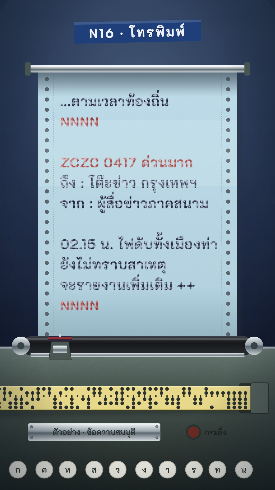

# N16 โทรพิมพ์ · Teleprinter

**Fits:** spies and intelligence, modern history (1930s–1980s), breaking events, "the message that arrived at 2
a.m." openings, cables and telegrams ·
**Formats:** 9:16 · **Code:** `Demo.tsx` + `kit/Teleprinter.tsx`

## Look

A teleprinter at night under cold fluorescent light. A continuous roll with pin-feed sprocket holes and perforated
tear lines rises out of the machine over a black rubber platen and curls over a chrome bail at the top. The paper
takes the cold cast of the light (pale blue-grey); the wall around it falls to navy-black. Every character is a
**dot-impact glyph**: the font is printed through a 5 px dot grid that travels with the paper, with a faint
ribbon smudge behind; headers and `ZCZC`/`NNNN` are in the red half of the ribbon. Below: hammertone housing with
chrome trim, a reperforator slot from which a yellow **punched tape** runs across the frame (5 data channels + feed
hole, one column per character), a riveted plate, a bell lamp and a row of round keys.

| Role | Hex |
|---|---|
| Wall (outside the lamp) | `#17213a` → `#0a0f1c` |
| Paper under cold light | `#b4d3e0` (curl `#8fb0c0`) |
| Ribbon ink black / red | `#2a2440` / `#b3322b` |
| Housing | `#6c7d76` → `#4d5b55` → `#1c2321` |
| Punched tape | `#e8d98a` |

**Type:** K2D 700 at 54 px, letter-spacing 2, through the dot mask; 80 px line feed. Labels (wall tape, plate)
K2D 700 solid. **Line:** none — dots only.

## Motion signature

- **Type-on:** one character every 1.7 frames, the print head riding the line and dipping on each strike, a key
  on the keyboard going down, a tape column punched.
- **Bell / carriage return:** at each line end the bell lamp flashes (house-library `ship_bell`, very low), the
  head snaps back to the margin in 6 frames and the roll feeds up one line with an ease (12 frames per return).
- Blank line = feed with no text. The fluorescent pool hums (±3 % brightness).
- Never cut away from the roll mid-message; a new message starts with `ZCZC`, ends with `NNNN`.

## Scenes in the kit (`kit/Teleprinter.tsx`)

| Component | Shows | Props |
|---|---|---|
| `TeleDefs` | Dot mask, gradients, hammertone / fibre / smudge filters | — |
| `Roll` | Paper with sprocket holes, tear lines, page perforations; children = text | `x, y, w, h, offset` |
| `DotText` | Dot-impact text line | `x, y, text, size, color, font` |
| `Bail`, `Carriage` | Paper bail; platen, rail and print head | `hx` head x, `strike` 0–1 |
| `Housing`, `Keys` | Machine body; round keys (`pressed` index) | `y, w, h` / `labels` |
| `Tape`, `code5` | Punched tape from a list of codes; illustrative 5-bit code per character | `x0, y, codes` |
| `cells` | Visible advance of a Thai string (combining marks take no width) | `s` |

`Demo.tsx` holds the scheduler (`SCHED`): start, end and return frame of every line — reuse it for any message.

## Build notes

One SVG at 1080×1920. The dot mask is defined in each `DotText`'s own coordinates, so the dots move with the line
during a feed (no shimmer). `CELL` (31 px) is the advance per visible Thai/Latin character at 54 px; change both
together. The tape code is illustrative, not real ITA2 — say so if the video is about telegraphy itself.

## Facts in the demo

The bulletin is generic and fictional, marked "ตัวอย่าง · ข้อความสมมุติ" on the machine plate. `ZCZC` and `NNNN` are the
standard start- and end-of-message markers of telex traffic. For a real story, put real sourced text on the roll
and keep its source in this section of the episode notes.

## Don'ts

- Not a recon film or dossier (M04) and not a newspaper page (N09): no photos, no columns, no halftone.
- No smooth fonts on the roll — every printed glyph goes through the dot mask.
- No warm lamp light; the light is cold. Keep red ink for headers only.
- Don't fake a real agency's header, logo or a real classified document.

## Credits

All pictures drawn in code. Sound: template `SFX.tick`, `SFX.swell`; house library `ship_bell`. Font: K2D (SIL
Open Font License).
