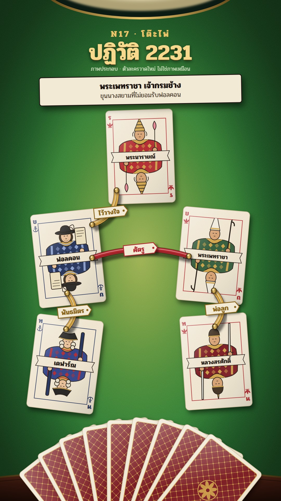

# N17 โต๊ะไพ่ · Card Table

**Fits:** intrigue, factions, coups, succession fights, "who is allied with whom" · **Formats:** 9:16 ·
**Code:** `Demo.tsx` + `kit/Cards.tsx`

## Look

The story is a hand of playing cards on a card table seen from straight above. Bright billiard-green baize lit by
a hanging lamp (the brass rim of the shade cuts into the top edge; a warm pool of light in the middle, the baize
falling darker toward the edges), fine baize fibre, a mahogany rail with a brass strip at the bottom. Every person
is an **original double-ended court card**: cream card stock with paper grain and a gloss sweep, a thin border in
the suit colour, corner indexes (a Thai rank letter + an original suit pip: lotus = Siamese court, anchor =
foreigners who came by sea), a half-figure mirrored top/bottom with a robe of diamond-pattern bands, hat and held
item that identify the role, and a name banner on the centre line. Relations are **silk ribbons** pinned between
cards with brass tacks — gold = allied/trusted, red = hostile — each with a small paper tag ("พันธมิตร", "ศัตรู",
"พ่อลูก"). The rest of the court lies face down as a fan of red-lattice backs along the bottom.

| Role | Hex |
|---|---|
| Baize (lamp centre → edge) | `#6c9e36` → `#237a2e` → `#0e4419` |
| Card stock | `#f3ead6` |
| Hostile ribbon / lotus suit / card back | `#b3262e` (backs `#7a1620`) |
| Allied ribbon, brass, gold foil | `#d4a64a` |
| Ink, text on cards | `#1c1410` |
| Anchor suit | `#1f2f5c` |

**Type:** Pridi 700 (titles, names, tags) and 400 (caption second line). Title 84 px gold foil `#f6d98c` with a
dark emboss shadow; kicker 34 px letter-spaced; names on cards 23–26 px. **Line:** 2.2 px ink outline on the court
figures only; table, ribbons and tokens are shaded shapes (gradients, soft drop shadows), never outlined.

## Motion signature (`flip-deal`)

- **Deal:** cards slide out of the fan to their places (18 frames, ease-out), lifted (bigger, long soft shadow)
  while travelling, landing with a small random tilt.
- **Flip:** a card turns about its long axis (|cos| x-scale, 14 frames) with a lift bump; back → face.
- **Tie:** a ribbon draws from one pin to the other (26 frames), the tag swings in when it lands.
- **Fall:** a fallen player's card is turned face down, its ribbons snap in the middle and pull back to the pins.
- **Rise:** the winner's card slides to the centre and the brass crown token moves onto it; the old king's card is
  pushed aside, tilted and dimmed.
- The lamp flickers ±3 %; the camera never moves.

## Scenes in the kit (`kit/Cards.tsx`)

| Component | Shows | Props |
|---|---|---|
| `TableDefs`, `Table` | gradients, patterns, filters; baize, lamp rim, rail | `light` 0–1 |
| `Card` | one card on the table (back or face) | `x, y, rot, flip 0–1, lift 0–1, dim 0–1`, children = face |
| `Face`, `Court` | double-ended court card for a person | `c: Court` (name, rank, suit, robe, trim, hat, item, beard) |
| `Back`, `Pip` | card back; suit pip | `suit: "lotus" \| "anchor"` |
| `Ribbon`, `ribbonMid`, `pinPoints` | pinned silk ribbon, its mid point for a tag | `a, b, color, p, cut, sag` |
| `Tag` | paper tag on a ribbon | `x, y, text, color, k` |
| `CrownToken` | brass token that changes hands (power, the throne, the prize) | `x, y, s` |

Hats: `crown`, `lomphok`, `plume`, `tricorn`, `spike`; items: `sword`, `lotus`, `scroll`, `baton`, `goad`. Add
new ones inside `Half` the same way (one path, 2.2 px ink outline, flat fill).

## Build notes

One SVG at 1080×1920 plus two DOM blocks (title, caption slip). Draw order: table → fan → cards → ribbons → tags →
token. Keep 5–7 face-up cards per scene (each card is ~60 shapes); more players = a second "hand" scene. The demo
cover is frame 352 (all ties drawn). Captions live in the slip under the title, one beat per slip.

## Demo story and sources

Siamese revolution of 1688 (พ.ศ. 2231): Phaulkon, Narai's Greek favourite, backed by French troops under General
Desfarges; Phetracha, head of the royal elephant corps, opposed him, with his son Luang Sorasak. Narai fell gravely
ill in May 1688; Phaulkon was arrested and executed on 5 June 1688; Narai died 11 July; Phetracha was crowned on
1 August; the French garrison left Siam later that year (Nov 1688). Sources: Wikipedia "Siamese revolution of
1688", "Constantine Phaulkon", "Phetracha". The cards are invented designs, not portraits (labelled on screen).

## Don'ts

- Do not copy a real deck's court cards, suits or back design; draw new ones.
- Not a board game: no grid, dice, counters or game board (that is M07); the table is plain baize.
- No camera moves or zoom cuts inside one table; change the hand instead.
- No photos of the people; no more than two ribbon colours plus one neutral.

## Credits

Everything drawn in code. Sound: template `SFX.whoosh`/`pop`/`tick`; house library `sword_draw`, `gong`, bed
`rain_light`. Font: Pridi (SIL Open Font License).
