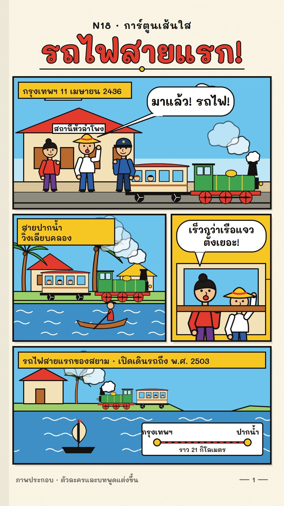

# N18 การ์ตูนเส้นใส · Clean-Line Comic

**Fits:** light history, anecdotes, "the first time …" stories, firsts and curiosities, kids' history ·
**Formats:** 9:16 · **Code:** `Demo.tsx` + `kit/Comic.tsx`

## Look

One printed page of an adventure comic. Warm paper with a faint grain and a binding shadow on the left; a title
lettered in red with a thick black outline; a panel grid (6 px black borders, 22 px white gutters, a slight offset
shadow under each panel). Inside the panels everything follows the **clean line**: one even black outline (4 px at
1:1) around every shape, flat bright fills, **no hatching, no gradients, no dots, no screentone, no shading** —
depth comes only from overlap and from flat two-band skies. Backgrounds are as carefully drawn as the people
(stations, locomotives, stilt houses, palms, boats, wave lines). Characters are original: round heads, dot eyes,
tube limbs. Thai lettering in round white balloons with a pointed tail; narration in flat yellow boxes.

| Role | Hex |
|---|---|
| Page paper | `#fbf6e6` |
| Red (title, roofs, buffer beams) | `#e23b2e` |
| Sky (two flat bands) | `#6cc3ec` / `#bfe6f5` |
| Yellow (narration, hats, domes) | `#f6c623` |
| Ink (every line, text) | `#141210` |
| Also: green `#3ea24f`, water `#3d8fc6`, wood `#b8692e`, skin `#f1c391` | |

**Type:** Mali 700 (title 112 px with 7 px black stroke, balloons 36–44 px), Mali 600 (narration 30 px).
Balloon line height 1.34 em so Thai upper marks never touch the line above.

## Motion signature (`slide-stack`)

- Panels slide in **one by one** in reading order (22 frames, strong ease-out, 260 px travel) from the side they
  sit on; nothing else on the page moves before its panel lands.
- Balloons pop (scale 0.7 → 1 with a small overshoot) ~30 frames after their panel; narration drops in 14 frames
  after the panel.
- Inside a panel: small cyclic life only — wheels turn, steam puffs drift and grow, palms sway ±4°, a waving arm,
  water lines scroll. No camera moves, no zooms on the page.

## Scenes in the kit (`kit/Comic.tsx`)

| Component | Shows | Props |
|---|---|---|
| `PageDefs`, `Page` | paper, grain, flat-band sky gradient | — |
| `Panel` | clip box + border; slides in | `id, x, y, w, h, enter 0–1, from` |
| `Balloon` | speech balloon with tail | `x, y, w, h, tx, ty, lines, size, k` |
| `Narration` | yellow caption box | `x, y, w, lines, size, k, color` |
| `Person`, `Toon` | original clean-line character | `look {shirt, pants, hat: straw/cap/bun/none}, wave, phase, flip, mouth` |
| `Loco`, `Coach` | steam tank engine, wooden coach | `x, y, s, spin` (wheels) |
| `Puff`, `Palm`, `StiltHouse`, `Boat`, `Water` | scenery | see code |

## Build notes

One SVG at 1080×1920. A page holds 3–5 panels; a new page = a new set of panels sliding in over a fresh `Page`.
Keep every line the same weight at its scale (pass `strokeWidth={LW}`; scaled groups keep their outline width by
design). The demo cover is frame 400 (all panels in).

## Demo story and sources

The Paknam Railway, Siam's first railway line: opened 11 April 1893 (พ.ศ. 2436), about 21 km from Bangkok
(Hua Lamphong area) to Paknam (Samut Prakan), closed in 1960 (พ.ศ. 2503). Source: Wikipedia "Paknam Railway".
Characters and dialogue are invented ("ตัวละครและบทพูดแต่งขึ้น" on the page); the station sign and engine are
illustrations, not copies of the real ones.

## Don'ts

- No Ben-Day dots, halftone or speed-line bursts (that is pop-art), no screentone (manga), no hatching or
  crosshatch, no soft gradients inside panels.
- Do not imitate a specific comic artist, series or its characters; draw new people.
- Do not depict Thai royalty as comic characters; tell royal parts in narration boxes.
- Do not vary the line weight for expression; even line is the style.

## Credits

Everything drawn in code. Sound: template `SFX.whoosh`/`pop`; house library `ship_bell`, `whistle_officer`, bed
`ship_sailing`. Font: Mali (SIL Open Font License).
