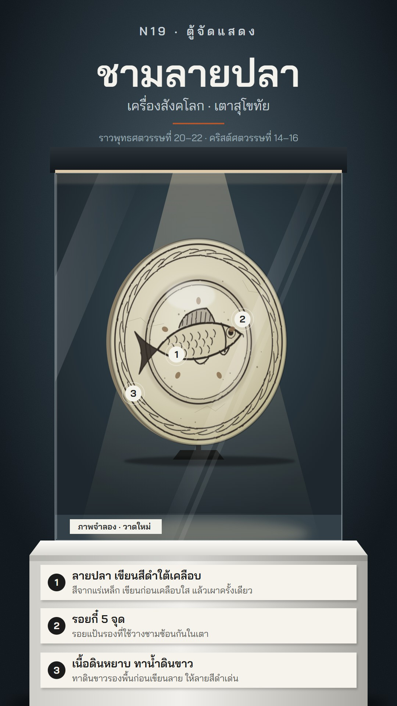

# N19 ตู้จัดแสดง · Museum Vitrine

**Fits:** one artefact per scene — ceramics, weapons, coins, tools, inventions, regalia replicas, "what is this
object and why does it matter" · **Formats:** 9:16 · **Code:** `Demo.tsx` + `kit/Vitrine.tsx`

## Look

A single object in a lit museum case. Dark blue-charcoal gallery wall with a soft wall-wash behind the case and a
faint grain; wall-vinyl type above (kicker, object name, kind and kiln/maker, date). The glass case: a dark lid
with a warm light strip, a narrow spotlight cone onto the object, a pool of light on the deck, thin bright glass
edges and two slow diagonal reflection streaks across the front. The object sits on a black acrylic stand,
**drawn in code with real material cues** (glaze gradient, brushwork with ragged edges, spur marks, iron spots,
crackle, a moving specular highlight, rim thickness when turned). Under the case a white plinth in perspective
carries numbered **museum label cards**; matching numbered dots sit on the object.

| Role | Hex |
|---|---|
| Gallery wall (lit centre → edge) | `#4b5c66` → `#1a252e` → `#0d1419` |
| Plinth | `#ecebe6` (shade `#b9b8b2`) |
| Object (demo glaze) | `#ece6d2` → `#a99c78`, brushwork `#2b221d` |
| Accent rule | `#b5562c` |
| Label card / text | `#f6f3ec` / `#1b1b1b` |
| Spot light | `#ffe8c2` |

**Type:** Bai Jamjuree — 600 for the object name (104 px, off-white on the wall) and label headings (30 px), 400
for the subtitle, date and label lines (24–36 px). Kicker 32 px with wide letter-spacing. **Line:** none on the
case and labels (shape and light only); the object's own decoration is the only line work.

## Motion signature (`turntable`)

- The object turns slowly about its vertical axis on the stand: one full turn per scene (here 18 s) — face,
  edge, back, face. Turning is drawn as x-scale |cos θ| plus a rim-thickness offset and a specular highlight that
  slides with sin θ; the back shows the unglazed base.
- Callout dots pop on the object (12 frames, small overshoot) and follow it while it turns; they hide when the
  face turns away (cos θ < 0.3). Each label card fades up 6 frames after its dot.
- Reflections drift ±40 px very slowly; the camera never moves.

## Scenes in the kit (`kit/Vitrine.tsx`)

| Component | Shows | Props |
|---|---|---|
| `GalleryDefs`, `Gallery` | wall, gradients, glaze/clay fills, brush filter | — |
| `CaseBack`, `Spot`, `CaseGlass` | case interior, spotlight cone + pool, glass front + lid | `k`, `drift` |
| `Plinth` | white plinth; children drawn on its front | children |
| `FishPlate` | Sukhothai-type underglaze black fish plate on a stand | `cx, cy, R, theta` |
| `Marker` | numbered callout dot | `x, y, n, k` |
| `LabelCard` | museum label (number, heading, one line) | `x, y, w, n, head, line, k` |

New object: write a component like `FishPlate` taking `theta` — draw the front inside a group scaled by
`|cos θ|`, switch to the back when `cos θ < 0`, add the rim/edge shape offset by `sin θ`, keep the specular. Place
callouts in object coordinates and map them with `x = cx + u·cos θ`.

## Build notes

One SVG at 1080×1920. Draw order: gallery → wall vinyl → case back → spot → object → markers → deck label → glass
→ plinth + labels. Three callouts per object is the comfortable maximum at phone size. The demo cover is frame 150
(face nearly frontal, all three callouts in). Always keep the "ภาพจำลอง · วาดใหม่" deck label: the object is a
drawn reconstruction, not a photo of a museum piece.

## Demo object and sources

Sangkhalok (Sawankhalok) ware from the Sukhothai kilns, roughly 14th–16th century CE (พุทธศตวรรษที่ 20–22): plates
with a fish painted in iron-oxide black under a clear glaze, a coarse grey-brown body covered with white slip
before painting, and spur marks in the well from the disc supports used to stack pieces in the kiln (commonly
five). Sources: Wikipedia "Sawankhalok ware" / "Sukhothai kilns"; Roxanna M. Brown, *The Ceramics of South-East
Asia: Their Dating and Identification* (1988). The drawn plate is a generic example, not a copy of a specific
museum object; dates are approximate.

## Don'ts

- No photos of real museum objects or museum logos/branding; no real accession numbers.
- Not a dark glass dashboard: no UI chrome, charts or glowing panels — it is a physical case in a room.
- Don't over-label: max three callouts, short lines.
- Don't spin fast or flip the object; one slow turn per scene.

## Credits

Everything drawn in code. Sound: template `SFX.swell`/`pop`; house library bed `city_crowd` (gallery murmur, very
low). Font: Bai Jamjuree (SIL Open Font License).
