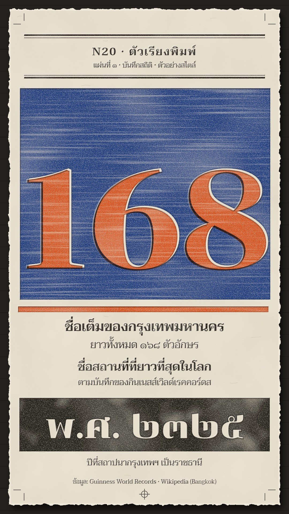

# N20 ตัวเรียงพิมพ์ · Letterpress Broadside

**Fits:** data stories, records, giant numbers, "how many / how long / since when" · **Formats:** 9:16 ·
**Code:** `Demo.tsx` + `kit/Press.tsx`

## Look

A broadside printed on a hand press. A thick cotton sheet with a deckled edge lies on the dark press bed; the
paper has cloudiness, fibre grain and a few long cotton fibres. Big statements are **wooden type**: a solid
wooden slab inked in blue with the numerals cut out of it so the paper shows, then the numerals overprinted in
orange a few pixels off register; a black slab with the date cut out. Supporting lines are **small metal type**
(Taviraj) in black between printer's rules (thick + thin double rules). Every inked area carries the press:
speckled voids where fibres did not take ink, horizontal wood-grain streaks in wooden solids, uneven inking across
a block, a darker rim where ink squeezed to the edge, and a **debossed impression** (inner shadow upper-left, light
lip lower-right). Crop marks in the corners, a registration target at the foot.

| Role | Hex |
|---|---|
| Press bed (around the sheet) | `#24211e` |
| Cotton paper | `#efe8d8` (shade `#d9d0bc`) |
| Ink 1 — blue (big slab) | `#1f3f99` |
| Ink 2 — orange (numerals, rules) | `#ec5a24` |
| Ink 3 — black (metal type, date slab) | `#1c1a18` |

**Type:** Chonburi 400 for wooden type (giant numerals 520 px with −18 tracking, words 128–168 px; Thai numerals
for dates); Taviraj 600/400 for metal-type captions (32–52 px). Inks blend with `multiply` so overprints mix.

## Motion signature (`press-stroke`)

- Each ink is one **press stroke**: the platen's shadow comes down over the sheet (10 frames), contact (3 frames:
  the sheet squashes 0.4 %, a `wood_hit` thump), the platen lifts (14 frames) and the new ink is there with a
  short wet sheen.
- One colour per stroke, in printing order (black captions → blue slab → orange overprint → black + orange); the
  number is revealed by the stroke, never typed on or counted up.
- Between strokes the sheet is still. No camera moves.

## Scenes in the kit (`kit/Press.tsx`)

| Component | Shows | Props |
|---|---|---|
| `PressDefs` | ink filters (3 passes), deboss, paper, deckle, platen gradient | — |
| `Sheet` | bed + deckled cotton sheet | — |
| `Inked` | wraps type/shapes as one inked pass | `ink "a"\|"b"\|"c"`, `fresh`, `dx, dy` (registration) |
| `Blind` | blind (uninked) impression | children |
| `Platen`, `stroke()` | platen shadow; timing of a stroke at a frame | `k`; `stroke(frame, at)` → `{k, printed, hit, fresh}` |
| `Marks` | crop marks + registration target | `color` |

Knock-outs (numbers cut out of a slab) are SVG masks in `Demo.tsx` (`lp-knock`, `lp-knock2`): white rect minus the
text in the same font and position as the overprint.

## Build notes

One SVG at 1080×1920. Filters are heavy: keep one `Inked` group per pass (not per word). Keep ≥ 40 % of the sheet
inked on a cover frame — a mostly-empty cream sheet reads as a plain poster. The demo cover is frame 400.

## Demo story and sources

Bangkok's full ceremonial name has 168 letters and is listed by Guinness World Records as the world's longest
place name; Bangkok (Rattanakosin) was founded as the capital in 1782 (พ.ศ. 2325). Sources: Wikipedia "Bangkok"
(Name section), Guinness World Records "Longest place name".

## Don'ts

- Not minimal Swiss: no clean flat vector solids, no sans-serif grids, no empty white space as the design.
- No halftone dots (newsprint), no grain overlay on unprinted paper beyond the cotton texture.
- No count-up animations; the press reveals the finished number.
- Do not imitate a specific poster, printer's mark or type foundry specimen.

## Credits

Everything drawn in code. Sound: house library `wood_hit` (press thump), template `SFX.whoosh` (platen coming
down). Fonts: Chonburi, Taviraj (SIL Open Font License).
