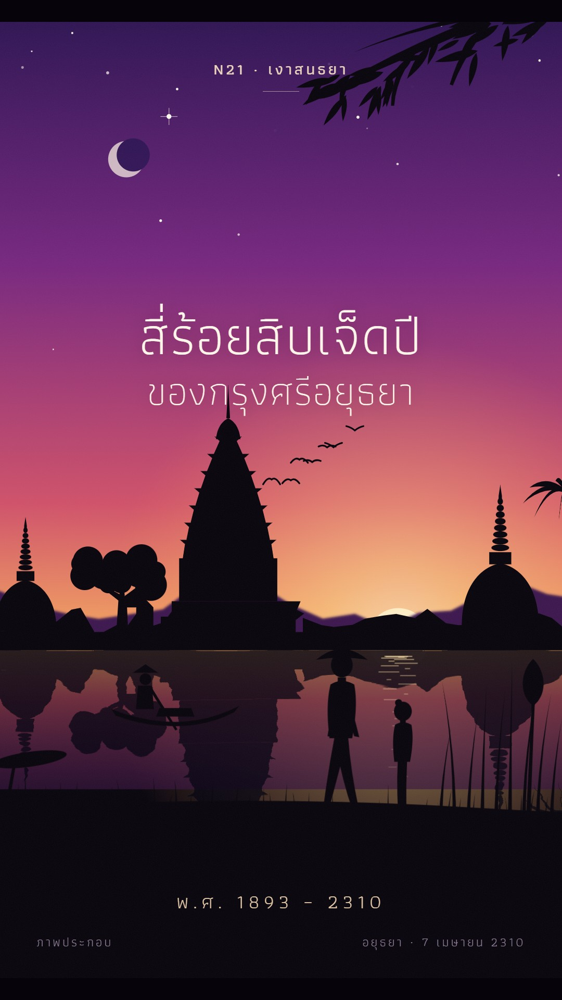

# N21 เงาสนธยา · Twilight Silhouette

**Fits:** emotional moments, endings, farewells, "the last day of …", the closing scene of a long history video ·
**Formats:** 9:16 · **Code:** `Demo.tsx` + `kit/Twilight.tsx`

## Look

One long dusk. A vivid sky fills two thirds of the frame and deepens over the shot: deep violet at the zenith,
magenta in the middle, coral and gold at the horizon, with the sun sinking behind the land and a big soft glow
around it. Stars come out one by one (the brightest "evening star" first, beside a thin crescent moon). Against it
stand crisp, flat, pure-black silhouettes in layers — hazy violet hills far away, a ruin line of prang, chedi,
palms and trees, a still river that mirrors the sky and the ruins with a gentle ripple and a gold glitter path,
then the near bank with walkers, reeds and a lotus, and an overhanging branch at a top corner. The lower fifth is
solid black ground that carries the small type. A fine grain and thin black letterbox bars at top and bottom.

| Role | Hex |
|---|---|
| Zenith (start → end of the shot) | `#3a1a6e` → `#120a33` |
| Middle sky (magenta) | `#b42f86` → `#4b1f78` |
| Low sky (coral) | `#f2724a` → `#b83a7c` |
| Horizon gold / sun | `#ffc865`, sun `#fff1c8` |
| Silhouettes and ground | `#06030a` |
| Type | `#fff6ea` (lines), `#ffe9c8` (kicker), `#b9a6c4` (labels) |

**Type:** Athiti 200/300 for the story lines (thin, large: 76–104 px), 500 for the kicker (30 px, letter-spaced
5). At most two lines on screen; they fade in over 40 frames with a 14 px rise and fade out before the next.
**Line:** none. Silhouettes are solid flat shapes with no outline and no inner detail; detail is in the outline
only (prang tiers and petals, chedi rings, palm fronds, a hat brim).

## Motion signature

- **Dusk progression:** `k` 0 → 1 over the whole shot (sine ease) drives every sky colour, the sun sinking
  (`HORIZON − 95 + k·125`), the glow fading and the stars appearing (`Stars` are born by `k`, high ones first).
  Time passes inside one shot — that is what makes it feel like an ending.
- **Slow lateral drift in layers:** far hills × 0.08 px/frame, ruins × 0.22, near bank × 0.6, reeds × 0.9, the
  branch × 0.35, plus a +4.5 % push-in centred low. Nothing ever moves fast.
- Life in the silhouettes: walkers stroll (legs and arms swing), a rower glides and dips the oar, birds cross in
  a loose V, grass and reeds sway, the water glitter shimmers.
- Type: sparse, one thought at a time. A soft gong under the last line.

## Scenes in the kit (`kit/Twilight.tsx`)

| Component | Shows | Props |
|---|---|---|
| `TwilightDefs` | Sky/water gradients, sun glow, haze, ripple and grain filters | `k` |
| `Sky`, `Stars` | Gradient sky, sinking sun, crescent moon, stars born by `k` | `k, frame` |
| `Drift` | Layer wrapper that slides sideways (`haze` blurs it) | `x, haze` |
| `FarHills` | Distant hills tinted toward the sky | `k` |
| `Prang`, `Chedi`, `RuinWall`, `Palm`, `Tree` | Ruin-line silhouettes standing on `HORIZON` | `x, y, h` |
| `Water` | Mirrored sky + rippled mirror of any group + glitter | `top, h, frame, k, mirror` |
| `Boat`, `Walker`, `Birds` | Living silhouettes | `x, y, t` (+ `child`, `hat`) |
| `Bank`, `Reeds`, `Branch` | Near ground with grass, reeds and lotus, overhanging branch | `y`, `sway` |

For a new story, keep the sky and the layers and swap the silhouettes: a city skyline, a ship on the sea, a
battlefield after the battle, a single figure on a hill. Silhouettes are always one `INK` path each.

## Build notes

One SVG at 1080×1920. The mirrored ruins in `Water` are the same group drawn again inside `scale(1,-1)` with the
ripple filter — pass the same layer content and the same drift. Keep the type in HTML on top. Use 1–3 shots of
this per episode (endings, epilogues); a whole video in one dusk gets monotonous.

## Demo story and facts

"417 years of Ayutthaya, ended in flames." Ayutthaya was founded in 1351 (พ.ศ. 1893) and fell to the Burmese
(Konbaung) army on 7 April 1767 (พ.ศ. 2310), after a siege of about 14 months; the city was burned. Sources:
Encyclopaedia Britannica, "Ayutthaya" (historical kingdom); Wikipedia, "Ayutthaya Kingdom" and "Fall of Ayutthaya".
The silhouettes are generic illustration ("ภาพประกอบ"), not a drawing of a specific temple.

## Don'ts

- No colour on silhouettes, no gradients or rim light on them, no outlines.
- Not amber/brown firelight (that is N05) and no outlined illustration (N01): the sky is violet–magenta–gold.
- No fast cuts or pans inside one dusk; change the shot, not the speed.
- No more than two lines of type at once; no boxes or cards behind text.

## Credits

None for pictures — everything is drawn in code. Sound: house library `wind` bed and `gong` (`npm run sfx-lib`),
template `SFX.swell`. Font: Athiti (SIL Open Font License).
