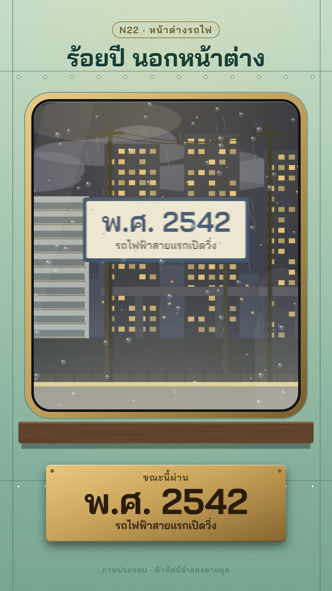

# N22 หน้าต่างรถไฟ · Train Window

**Fits:** long periods told fast — "100 years in 60 s", how a city or a country changed, a reign or a dynasty in
one ride; also as a bridge between chapters of a long video · **Formats:** 9:16 · **Code:** `Demo.tsx` +
`kit/Window.tsx`

## Look

The viewer sits inside an old carriage. A pale mint painted steel wall with panel seams and rivets surrounds one
big round-cornered window in a brass frame with a black rubber gasket; under it a varnished wooden sill and a
brass plaque. Through the glass the timeline scrolls past: sky and low clouds, far hills or a hazy skyline, the
buildings of each era beside the line, the embankment, and telegraph poles flicking past in front. Rain beads on
the glass (each drop with a highlight and a dark lower rim) and streaks backwards with the train's speed; a faint
fog at the bottom of the pane, a reflection of the carriage lamp and of a passenger's profile. Each era has its own
time of day: hazy morning over rice fields, grey rain over shophouses, a dusk over concrete blocks, night with lit
towers and an elevated line.

| Role | Hex |
|---|---|
| Carriage wall (top → bottom) | `#c4e6d6` → `#a3cdb9` → `#7aa995` |
| Brass frame and plaque | `#c8a35a` (light `#f1d08a`, dark `#7c5f2c`) |
| Station board / border | `#f6f2e6` / `#1f3c6b` |
| Lit windows at night | `#ffd37a` |
| Wall text | `#173f33`; plaque text `#2a1c0b` |

Era skies (top, horizon): 2439 `#c9cfc4`/`#efe3c4` · 2475 `#8e9eab`/`#c9d0d2` · 2525 `#5b5a83`/`#e79a6c` ·
2542 `#0d1326`/`#2c3558`.

**Type:** Bai Jamjuree 700 for the title (78 px), the station boards (92 px year, 34 px event) and the plaque
(108 px year); 600 for small lines. **Line:** none — flat shapes; the only "lines" are wires and the board border.

## Motion signature

- **Parallax past the glass:** near layer (poles, boards, platform) at the train's speed, mid layer (buildings)
  × 0.34, far layer × 0.06, clouds × 0.03. The near layer is motion-blurred horizontally by the speed
  (`stdDeviation = speed × 0.55`), so it smears at cruise and sharpens at a station.
- **Stations:** the train cruises at 24 px/frame and slows to 3.5 px/frame as each station board passes the middle
  of the window (`travel()` integrates the speed profile; boards are placed where the train is at that frame).
  The board is the beat: year big, event under it, a station bell on the same frame.
- **The era changes with the ground:** each mid-layer building belongs to the era of the stretch of line it
  stands on (half way between stations), so the next era rolls in from the right before its board arrives; the
  sky, ground and paddy fields cross-fade over ~50 frames.
- The plaque counts the year up between stations and gives a small stamp (scale +8 %) when a station is passed.
- Carriage rocking: ± 1.5 px vertical sway; rain beads slide down in jerks.

## Scenes in the kit (`kit/Window.tsx`)

| Component | Shows | Props |
|---|---|---|
| `WindowDefs` | Glass clip, sky gradient, motion-blur, wood and grain filters | `blur, sky` |
| `Outside` | The scene inside the glass (clip + sky); put layers in it | children |
| `Weather` | Low clouds and rain outside | `p, frame, speed, tint` |
| `FarLand` | Hills (old eras) or hazy skyline with lit windows (night) | `p, now` |
| `MidLand` | Buildings per era: stilt houses + sugar palms, shophouses, concrete blocks + billboard, towers + viaduct | `p, era, frame` |
| `Embankment` | Ground, flooded paddy rows (fade with `paddy`), ballast, fence | `p, land, paddy, sky` |
| `NearLayer`, `StationSign` | Poles + wires, station boards with a platform | `p, signs, font` |
| `Rain`, `Reflection` | Beads and streaks on the glass; lamp, profile and fog reflections | `frame, speed` |
| `Carriage`, `Plaque` | Wall, rivets, brass frame, sill; the year plaque (HTML) | `year, event, stamp` |
| `travel`, `speedAt`, `layerItems` | Speed profile and parallax item placement | — |

For a new timeline: list the eras (year, event, sky, land), add a building function per era to `MidLand`, and
put the station frames on the spoken years. 4–6 stations per minute read well.

## Build notes

Everything except the plaque and the title is one SVG at 1080×1920. `travel()` loops over all frames up to the
current one — cheap at 30 fps for a few minutes; cache it if a single shot gets much longer. Keep each era's
buildings visibly different in silhouette, not only in colour, so the change reads at phone size.

## Demo story and facts

About a hundred years of Bangkok from the train: 2439 the first state railway, Bangkok–Ayutthaya, opened on
26 March (ร.ศ. 115; by today's reckoning 1897 CE, Thai sources write พ.ศ. 2439 in the old calendar) — State
Railway of Thailand history page and Wikipedia "State Railway of Thailand"; 2475 the Siamese revolution of
24 June 1932 — Wikipedia "Siamese revolution of 1932"; 2525 Bangkok's bicentennial (Rattanakosin founded 1782) —
Wikipedia "Rattanakosin Kingdom"; 2542 the BTS Skytrain, Thailand's first rapid-transit line, opened on
5 December 1999 — Wikipedia "BTS Skytrain". The scenery is a generic illustration of each era ("ภาพประกอบ ·
ทิวทัศน์จำลองตามยุค"), not a view from a real line.

## Don'ts

- Don't show the train itself or the track from outside — the camera never leaves the seat.
- No real railway logos, liveries or the exact design of real station signs.
- Don't put more than one board in the window at once; don't cut — the ride is one continuous shot.
- Keep the wall pale mint and the brass warm; a dark wall loses the "old carriage on a rainy day" feel.

## Credits

None for pictures — everything is drawn in code. Sound: house library `rain_light` bed and `ship_bell` (used as a
station bell), template `SFX.whoosh` (`npm run sfx-lib`). Font: Bai Jamjuree (SIL Open Font License).
