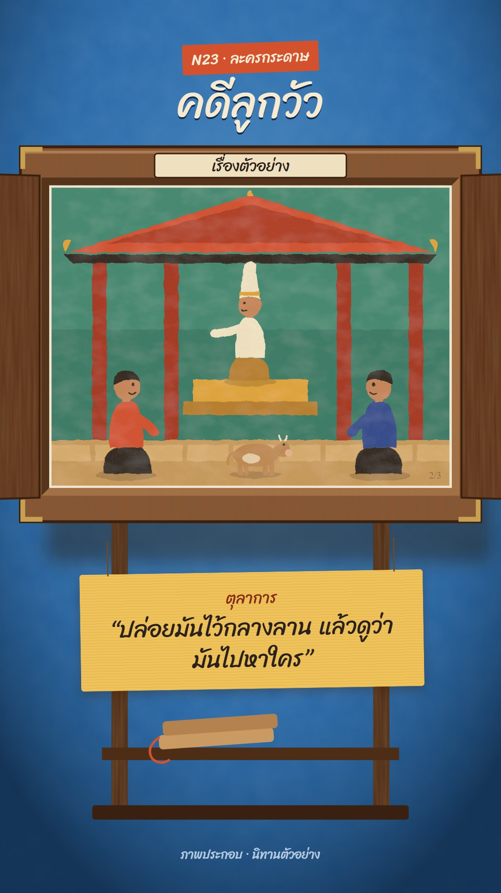

# N23 ละครกระดาษ · Kamishibai Paper Theatre

**Fits:** dialogue scenes, court drama, folk tales, fables, "who said what" moments, children's history ·
**Formats:** 9:16 · **Code:** `Demo.tsx` + `kit/Butai.tsx` (box stage) + `kit/Cards.tsx` (painted pieces)

## Look

A small wooden box stage on a wooden stand, in front of a cerulean-blue plaster wall under a soft spotlight. The
box has a thick bevelled frame with vertical grain, brass corners, a cream title plate on top and a slot on the
right side. Two panelled doors swing open to the sides. Inside, a painted story card in opaque gouache: flat matte
colour fields (vermilion, ochre, viridian, ultramarine, cream), slightly wobbly brushed edges, a gentle chalky
mottling and paper tooth, simple round-headed figures with dot eyes. Under the box a yellow paper tag hangs on two
cords with the spoken line, and the teller's wooden clappers rest on the stand's shelf.

| Role | Hex |
|---|---|
| Wall (spot centre → edge) | `#6aa6da` → `#2a6aa8` → `#0f2a48` |
| Box wood / dark wood | `#8a5632` / `#4e2d17`, brass `#c7a052` |
| Gouache: vermilion, ochre, viridian, ultramarine | `#d4512e`, `#e2a63b`, `#2e7b67`, `#2b4a8e` |
| Card paper / skin | `#f2e4c4` / `#c9875a` |
| Tag / ink | `#efc35a` / `#2a211d`, speaker `#8a2a14` |

**Type:** Sriracha 400 everywhere (hand-lettered feel): title 92 px cream with a dark drop, the speaker 34 px,
the line 50 px, the kicker 32 px on a vermilion slip. **Line:** brush — no outlines; edges come from the gouache
filter's wobble.

## Motion signature

- **Opening:** two clapper hits (house library `wood_hit`), then the doors swing out over ~44 frames
  (`Doors open` 0 → 1; the outer edges grow taller as they come toward the viewer, then show their inner face).
- **Card pull (slide-stack):** the current card slides out through the right-hand slot over ~32 frames with an
  ease-in-out, revealing the next card already in the box. The **half pull** — stop at 42 %, hold ~18 frames,
  then pull out — teases the answer and is the move to use before a reveal.
- The tag swings in on its cords (back-ease) with each new line and keeps a slight sway.
- The whole scene pushes in by 6 % over the shot. Cards themselves don't animate — they are paintings.

## Scenes in the kit

| Component | Shows | Props |
|---|---|---|
| `ButaiDefs` | Gouache, wood, plaster filters; spotlight; opening and slot clips | — |
| `Wall` | Plaster wall + spotlight + the box's cast shadow | — |
| `Stage` | Next card (inside) + current card pulled out through the slot | `back, front, pull` |
| `Box` | Wooden frame, slot, corners, title plate, stand, clappers | `title, font` |
| `Doors` | The two doors swinging open | `open` 0–1 |
| `Card` | One 840×630 painted card; children are painted with the gouache filter | `x, y, n, total` |
| `Person` (`kit/Cards.tsx`) | Figure: `stand`, `pull`, `kneel`, `sit`, `point`; hat `ngob`, `tall`, `none` | `x, y, s, shirt, pants, face` |
| `Cow` | Calf or cow, standing or running | `x, y, s, color, run, face` |
| `FieldBack`, `CourtBack`, `YardBack` | Painted backdrops | — |

For a new story, paint new cards from the same pieces: large flat colour fields first, then figures, one strong
colour per character kept the same on every card (the audience follows the colours).

## Build notes

One SVG at 1080×1920 plus HTML for the title and the tag. Only two cards are in the DOM at a time (`Stage` back
and front). Every wood filter composites `in` the source graphic — without that, turbulence fills the whole
bounding box and paints grain over the card.

## Demo story

A generic folk-tale-style example ("นิทานตัวอย่าง", "เรื่องตัวอย่าง" on the title plate): two farmers claim the
same calf, the judge has it let loose in the yard, it runs to its mother. Not a real case; no historical claim.

## Don'ts

- Not a shadow theatre (N05) and not a game show (N11): lit wall, wooden box, painted colour cards — no
  silhouettes, no neon, no stage lights.
- No outlines, gradients or 3D shading on the cards; gouache is flat and matte.
- Never move characters inside a card; change the card.
- No more than ~12 words on the tag.

## Credits

None for pictures — everything is drawn in code. Sound: house library `wood_hit` (clappers), template
`SFX.whoosh` and `SFX.pop` (`npm run sfx-lib`). Font: Sriracha (SIL Open Font License).
