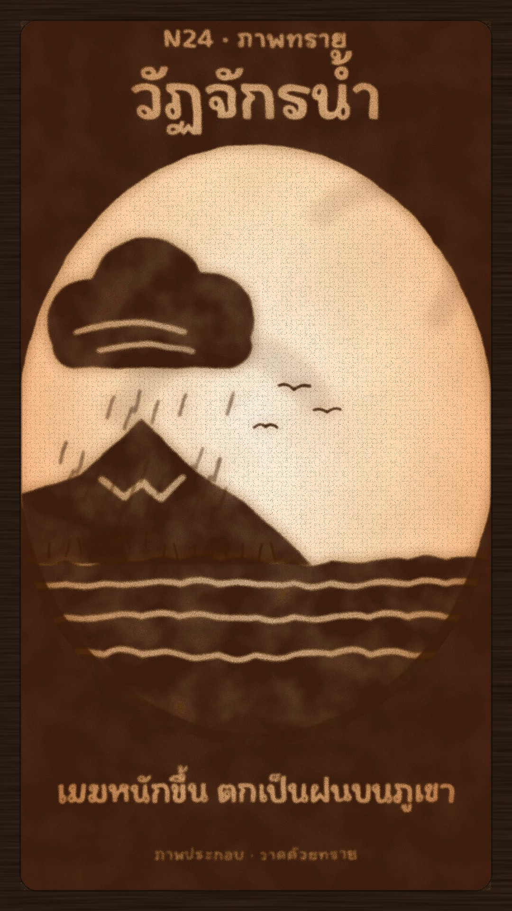

# N24 ภาพทราย · Sand Art

**Fits:** education and explainers (cycles, processes, "how it works"), stories told by hand, moving tributes,
intros · **Formats:** 9:16 · **Code:** `Demo.tsx` + `kit/Sand.tsx`

## Look

Sand animation on a light box, seen from above. A dark wooden bezel holds the glowing glass: hot warm white in
the middle falling to peach and burnt orange at the corners. Dark amber sand is pushed to the edges as a thick
frame with a big bright oval wiped clear in the middle; the title, the caption and the label are written into the
frame with a finger, so the light shows through the letters. Inside the oval each picture is made of sand: grainy
edges, a soft halo of loose grains around every shape, uneven thickness (thin patches glow through), finger lines
wiped through solid areas (sun ring, waves, snow line, river), faint smears where earlier pictures were swept
away, and loose grains all over the glass. Only sand and light — no paper, no pencil, no outlines.

| Role | Hex |
|---|---|
| Sand (thick) | `#3b1d09` |
| Sand halo / thin sand | `#5a2c0e` at 0.8 over the glow |
| Glow centre → mid → edge | `#fff3e2` → `#ffdcb4` → `#f5b07a` → `#d97a48` |
| Bezel | `#1a0e06` |

**Type:** KoHo 700, written as cut-outs in the sand frame: kicker 52 px, title 128 px, caption 66 px, label 32 px
(600). Captions fade in and out as the letters are wiped / refilled (mask opacity). **Line:** swept — no strokes;
lines are either sand trails (`drawn()` dash reveal) or finger wipes (`cut`).

## Motion signature

- **Morph by sweeping:** a picture is never cut away; it is blown apart (`scatter` 0 → 120: displacement grows,
  edges spread, it fades) while the next is poured in, and a faint smear stays where it was. Something carries
  over every time (the sea stays, the vapour becomes the cloud, the cloud drifts over the mountain).
- **Pouring:** a thin falling stream of grains (`Pour`) lands where new sand appears, with a small spreading pile;
  sea fills from the left, the sun disc grows from its centre, the mountain slides in from the left.
- **Drawing with a finger:** strokes reveal along their length (`drawn(k)`) — vapour, rain, river, the loop arrow;
  wipes (`cut`) open light lines in solid sand.
- Slow and continuous; no camera moves — the table never moves.

## Scenes in the kit (`kit/Sand.tsx`)

| Component | Shows | Props |
|---|---|---|
| `TableDefs`, `Table` | Glass clip, glow gradient, grains, faint dust, bezel | `glow` 0–1 |
| `Sand` | Turns plain shapes into sand; `cut` = finger wipes; `scatter` = blow apart | `id, scatter, opacity, seed, soft, even, cut` |
| `Pour` | Falling stream of grains + landing pile | `x, y, frame, on` |
| `Smear` | Faint arc of thin sand left by a sweep | `x, y, r, a0, a1, k, id` |
| `drawn(k)` | Dash props that draw a stroke 0 → 1 | — |

`soft` is the edge blur (≈2.6 for lettering and the frame, 3.5 for pictures, 16+ for smears); `even` 0–1 is how
evenly the sand is laid (0.8+ for lettering, 0.5 for pictures). Every `Sand` needs a unique `id`.

## Build notes

One SVG at 1080×1920. Every `Sand` is its own filter (two turbulences, blur, displacement) — keep it to ~15 on
screen; scene content goes inside the oval clip (`sa-oval`) so it merges with the frame instead of doubling it.
Text written into sand must be big (≥ 44 px) or the grain eats it.

## Demo story and facts

The water cycle in four steps — the sun warms the sea and water evaporates; vapour rises and condenses into
clouds; clouds drop rain (here on a mountain); water runs down rivers back to the sea. Standard science, see USGS
Water Science School, "The Water Cycle" (usgs.gov). Pictures are illustration ("ภาพประกอบ · วาดด้วยทราย").

## Don'ts

- Not tracing on a light box (M05): no paper, no pencil lines, no vellum, no ink — only sand and light.
- No colours other than the sand and the glow; no gradients on the sand.
- No hard cuts between pictures; sweep and re-pour.
- Don't fill the oval; sand art reads through its empty light.

## Credits

None for pictures — everything is drawn in code. Sound: house library `wind` and `rain_light` beds, template
`SFX.swell` and `SFX.whoosh` (`npm run sfx-lib`). Font: KoHo (SIL Open Font License).
