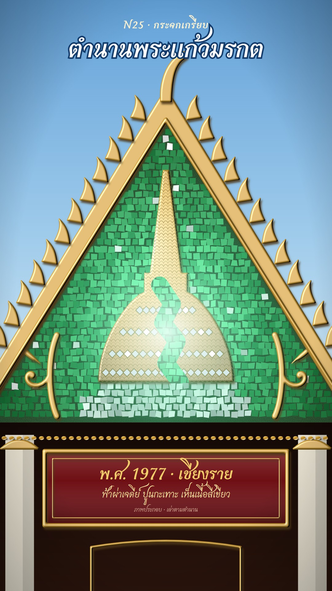

# N25 กระจกเกรียบ · Thai Glass-Tile Mosaic

**Fits:** temples, royal stories, legends, sacred objects and where they travelled · **Formats:** 9:16 ·
**Code:** `Demo.tsx` + `kit/Mosaic.tsx`, `kit/Pictures.tsx`

## Look

The story is set in the glass field of a temple gable (หน้าบัน). Inside the triangle every picture is made of
small pieces of mirror and coloured glass (emerald, ruby, sapphire, gold) pressed into a dark lacquer bed; each
piece sits at its own slight angle, so it has its own brightness, and pieces flash white as a band of light passes.
The main figure of each scene is raised **gilded stucco** — a domed gold mass with an incised scale pattern, a lit
bevel and a cast shadow — with mirror inlay, and kanok scroll vines in gilt curl in the corners. Around the glass:
heavy gilded bargeboards with bai raka fins and a chofa finial, a smooth painted sky above (not glass), and below
the hall: white columns, a gold-beaded lintel and a red lacquered name board that carries the caption.

| Role | Hex |
|---|---|
| Background (sky above the gable) | `#9cc9ea` (gradient `#5f9fd8` → `#d6ebf5`) |
| Main (emerald glass) | `#2cc58a` (deep `#0c5a26`) |
| Second (ruby glass) | `#8a161d` |
| Accent (gilded stucco) | `#d9a63a` |
| Text / dark (hall interior, lacquer bed) | `#2a140c`; caption gold `#f3cf6a` on board `#6e0f14` |

Mirror `#e6ecee`, sapphire `#1b4a9c`, lacquer bed `#0f3a1a`.

**Type:** Charmonman 700 (OFL, a looped Thai with a temple-sign feel) — title 90 px white with a 10 px navy
keyline on the sky; kicker 36 px; caption 58 px / 36 px gold leaf on the name board, honest label 22 px.
**Line:** "gilt-stucco": every line is a raised gold ridge (`Gilt`, 5–54 px) run through an emboss filter — a
blurred-alpha height map lit by a moving lamp plus a 4/7 px cast shadow. No flat outlines anywhere.

## Motion signature

- **Glint sweep:** a diagonal band of light (`u0`) runs across the glass continuously; pieces whose facet catches
  it flash to white and the brightest get a four-point star. The lamp of the gilt emboss filter swings ±40° so the
  gold relief changes too. The camera drifts slowly (≤ 4 % push, ±12 px) — the light stays fixed, so glints travel.
- **Tile re-set (scene change):** the glass turns over piece by piece from one point outward (each tile squashes
  to edge-on and comes back showing the next picture) — `Wall` with `A`, `B`, `flip` 0→1, `origin`.
- Reveals inside a picture use the glass itself: a seam of emerald opening through the gilt (mask + glow), a
  medallion lighting from mirror to emerald, a travelling glow along an inlaid river.
- Sound: a gong on each new picture, thunder on the strike, whoosh into a re-set.

## Scenes in the kit

| Component | Shows | Props |
|---|---|---|
| `Wall` (`kit/Mosaic.tsx`) | Every glass piece, shaded and flashing; re-sets from picture A to B | `A, B, flip, origin, u0, twinkle, clip` |
| `MosaicDefs` | Emboss, glow, plaster, gold, dome, scale pattern, seam glow | `az` (lamp angle) |
| `Gilt`, `GiltMass` | Raised gilt line / solid gilt mass with scales | `d, w, fill` / `d` |
| `Vine`, `KanokRow`, `Beads`, `cartouche()` | Kanok scroll vine, flame row, bead row, plaque outline | see code |
| `chediField(crack)` (`kit/Pictures.tsx`) | Emerald ground lit from a seam, mirror plinth | `crack` 0–1 |
| `journey(lit)`, `CITIES`, `riverPoint()` | Ruby ground, inlaid emerald river, five medallions | `lit` 0–5 |
| `throneField`, `busabokOutline()` | Sapphire ground with mirror rays; pavilion-throne outline | — |
| `GABLE`, `gablePath()`, `inGable()` | The gable triangle (clip for the glass) | — |

A new picture is a function `(x, y, tile) → { c: "#hex", k: "m" | "g" | "d" } | null` (mirror, coloured glass,
dull); return `null` outside the glass. Put the figure in gilt (`GiltMass`) and let the glass be ground and light.

## Build notes

About 3 000 visible tiles (22 px pitch, jittered quads) are recomputed every frame — fine for stills and renders;
keep pictures as cheap math (no per-tile path tests on long polygons). One `Wall` at a time. Clip the glass with
`clip="url(#…)"`; the grout bed is drawn only inside the clip. All randomness is seeded (`random()`), so frames
are stable.

## Data

None. The demo follows the chronicle tradition of the Emerald Buddha (labelled "เล่าตามตำนาน"): found in a chedi
struck by lightning in Chiang Rai, 1434 CE / พ.ศ. 1977; kept at Lampang (from 1436 / พ.ศ. 1979) and Chiang Mai
(1468 / พ.ศ. 2011); taken to Luang Prabang (1552 / พ.ศ. 2095) and Vientiane (1564); brought to Thonburi in 1779
and installed at Wat Phra Si Rattana Satsadaram, Bangkok, in 1784 / พ.ศ. 2327. Sources: Wikipedia "Emerald
Buddha" and "Wat Phra Kaew"; the Fine Arts Department / Bureau of the Royal Household pages on Wat Phra Kaew. The
image itself is not depicted — only light in a niche.

## Don'ts

- Not lacquer-gold-on-black (N10): the ground is always coloured glass, never black; the sky is a light colour.
- Not a stained-glass window (M16): no lead lines, no light coming *through* the glass — it reflects.
- No flat vector shapes inside the glass; every area is pieces. No outlines that are not raised gilt.
- Do not depict Buddha images in detail or in a disrespectful setting; use architecture, light and symbols.
- Do not copy a real temple's gable composition; arrange your own.

## Credits

Everything drawn in code. Font: Charmonman (SIL Open Font License). Sound: template `SFX.riser`, `SFX.whoosh`;
house library `thunder_close`, `gong`, `wind` (`npm run sfx-lib`).
