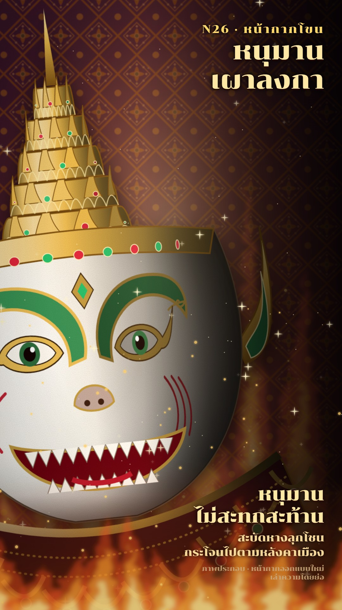

# N26 หน้ากากโขน · Khon Mask Theatre

**Fits:** Ramakien episodes, heroes and demons, any duel or confrontation told through two faces · **Formats:**
9:16 · **Code:** `Demo.tsx` + `kit/Khon.tsx`

## Look

Close-ups of painted and gilded khon masks, so close that one mask fills two thirds of the frame, tilted a few
degrees and pushed to the left; the lamp is on the left, the right third falls into shadow and carries the text.
A mask is lacquered colour (a green demon, a white monkey hero) with gold-painted eyes, brows and cheek scrolls, a
tall tiered gold crown set with red and green glass, flame-shaped gold ear ornaments, and an embroidered collar
under the chin. Behind: costume embroidery — sapphire silk with a gold diaper, sequins and glass stones — slightly
out of focus; gold glitter drifts and twinkles in the light. When fire comes, flames and embers rise from the
bottom and the silk warms to red-brown.

| Role | Hex |
|---|---|
| Background (stage black) | `#070407` (silk `#0c2a8c` under a dark veil) |
| Main (demon face lacquer) | `#1f8f4e` |
| Second (monkey face lacquer) | `#f2eee4` |
| Accent (gold leaf) | `#e8b84a` (deep `#7a4f10`) |
| Text | `#ffe7a6` |

Lips `#c0182a`, glass stones `#e0203a` / `#1fbf6a`, fire `#e8401a` → `#ffe08a`.

**Type:** Chonburi 400 (OFL) — title 80 px in two lines, right-aligned; kicker 36 px letter-spaced; caption 58 px +
34 px, honest label 22 px; all with a soft black glow. **Line:** "embossed" — gold features have a 2–3 px dark
edge and a lighter inner rim; faces have no outline beyond a 4 px dark edge; a fine lacquer/gold-leaf grain is
multiplied into the whole mask (`n26-shadow` filter).

## Motion signature

- **Turn in the light:** every feature sits on a curved face (`place(u, turn)`): as `yaw` changes, eyes, brows,
  jewels and crown petals slide round and narrow; the lamp angle `L` moves independently, so the gradient across
  the lacquer and the brightness of each gold piece change while the head turns. Turns are slow (0.5 rad over 5 s).
- **Hand-over between characters:** one mask turns away to edge-on (whole-mask squash past ~35°) and the next turns
  in from the other edge — no cuts.
- Breathing bob ±6 px, a slow push (≤ 5 %), glitter twinkles every frame; fire rises over ~2 s.
- Sound: war drums bed, a gong on each new face, fire crackle under the fire.

## Scenes in the kit (`kit/Khon.tsx`)

| Component | Shows | Props |
|---|---|---|
| `KhonDefs` | Lamp-driven face/gold gradients, brocade pattern, spot, fire, grain, shadow filters | `L` |
| `DemonMask`, `MonkeyMask` | The two original masks, with crown, ear ornaments and collar | `x, y, s, t: {yaw, L, R}` |
| `Feat`, `place()` | Put any new feature on the curved face at `u` (−1…1) | `u, y, t` |
| `Collar` | Embroidered collar under a mask | `t, w, y` |
| `Brocade` | Out-of-focus costume embroidery, drifting | `drift, dim` |
| `Glitter` | Twinkling gold sequins / dust | `frame, n, seed, area` |
| `Flames` | Soft flame tongues and rising embers | `frame, x, y, w, h, k` |

New characters (Rama green-blue, Lakshmana gold, other demons with different crowns and fangs): copy a mask, change
the lacquer colour in `C`, the eye shape, the mouth and the crown height; keep features on `Feat` so they turn.

## Build notes

One SVG. Faces use horizontal gradients whose stops are computed from the lamp angle every frame (no 3D). Keep the
yaw within ±0.5 rad for a readable face; beyond that use the edge-on squash. The grain filter is on the mask group
only, the blur only on the background.

## Data

None. The episode (Hanuman's tail is set alight in Lanka and he burns the city) is from the Ramakien, retold here
in our own words and labelled "เล่าความโดยย่อ". The masks are new designs, not copies of any maker's masks or of a
specific production ("หน้ากากออกแบบใหม่").

## Don'ts

- No full-body dancers or stage-wide shots — the style is the face in close-up.
- No flat colour faces: always the lamp gradient and the grain.
- Do not copy real masks (especially named masters' or museum pieces) or royal-performance photographs.
- Do not mix in other theatre looks (shadow puppets, neon game-show light).

## Credits

Everything drawn in code. Font: Chonburi (SIL Open Font License). Sound: template `SFX.whoosh`; house library
`war_drums`, `gong`, `fire_big`, `fire_crackle` (`npm run sfx-lib`).
