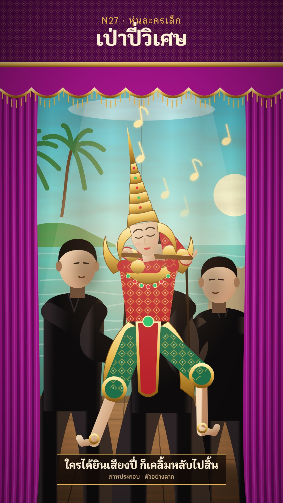

# N27 หุ่นละครเล็ก · Thai Small Puppet Theatre

**Fits:** folk tales, literature (Phra Aphai Mani, Khun Chang Khun Phaen), court stories, children's history ·
**Formats:** 9:16 · **Code:** `Demo.tsx` + `kit/Stage.tsx`

## Look

A small proscenium stage seen from the front row. Ban-yen pink velvet drapes with deep folds and a gold-fringed
valance frame a painted cloth backdrop (a turquoise morning sea, an island with palms, rocks; canvas weave, brush
mottling, a seam and soft folds). In the centre a rod puppet about a metre tall, in full costume — red brocade
jacket, gold collar with glass stones, upturned gold shoulder flames, green knee breeches with gold hems, a tall
gold crown — stands in the dance stance, its head and hands on thin dark rods. Right behind it, in plain sight,
three puppeteers in black (mandarin-collar shirts, bare feet) hold the rods and dance the same steps. One warm
follow-spot from the front with a visible beam; the floor is worn planks.

| Role | Hex |
|---|---|
| Background (velvet) | `#a8148c` (wall above `#5a0a50`) |
| Main (painted sky/sea) | `#5fd0d0` (sky `#1f9cc4` → `#f6ecb8`, sea `#1f9c94`) |
| Second (costume red) | `#b8202a` |
| Accent (gold) | `#e6b44a` |
| Text | `#fff0d6` |

Puppeteer black `#0d0b0c`, costume green `#1f6e4a`, painted skin `#f1d6b4`, floor `#8a5530`.

**Type:** Krub 700/500 (OFL) — kicker 34 px gold, title 78 px, caption 40 px in a dark box with gold rules, honest
label 22 px. **Line:** none — shapes are filled and shaded (gradients, brocade pattern); no drawn outlines except
thin gold edges on the costume.

## Motion signature — the rod dance

- The puppet moves only through its rods: head tilt, two hand rods (arms solved with two-bone IK), legs stepping
  in the deep-knee stance; the puppeteers' hands sit on the rod tips every frame and their bodies bob and step in
  the same rhythm (phase-shifted per puppeteer). That shared step is the signature — never animate the puppet alone.
- Entrances walk in from a wing with the whole group; poses change on eased 1 s moves (lift flute, wai, bow).
- The follow-spot pool travels with the puppet; the camera holds a slow 5 % push.
- Sound: a gong to open, wood knocks on the walking steps, a swell for the magic moment.

## Scenes in the kit (`kit/Stage.tsx`)

| Component | Shows | Props |
|---|---|---|
| `StageDefs` | Sky/sea gradients, canvas and brush filters, wood, spot, beam, cloth, skin, brocade | — |
| `Backdrop` | Painted cloth: sky, clouds, sun, sea, island with palms, rocks | `y0, y1, waves` |
| `Proscenium` | Velvet side drapes and fringed valance | `y0, y1, w, sway` |
| `Floor` | Plank stage in perspective | `y` |
| `Puppet`, `puppetRig()` | The rod puppet and its joints / rod tips | `p: Pose` (`x, y, head, armR, armL, step, bow, flute`) |
| `Puppeteer` | A puppeteer in black; hands go to two points | `x, y, h, hands, step, face` |
| `Notes`, `Spot` | Music notes drifting up, a light pool | see code |

To stage another story, paint a new `Backdrop` (palace, forest, river) and dress the puppet (colours in `C`, the
crown, a prop in the hands); keep the three puppeteers.

## Build notes

One SVG; the stage group is pushed ×1.24–1.3 so the puppet and the puppeteers fill the frame, the proscenium is
drawn on top unscaled. `puppetRig(pose)` gives rod tips — pass them as the puppeteers' `hands` so the grips stay
locked. Canvas/brush filters are full-frame rects: one backdrop at a time.

## Data

None. The demo is a generic sample scene ("ตัวอย่างฉาก"). Phra Aphai Mani was composed by Sunthorn Phu, usually
dated c. 1822–1844 (พ.ศ. 2365–2387, "ราว" on screen). Sources: Wikipedia "Phra Aphai Mani" / "พระอภัยมณี"; Office
of the Royal Society / Fine Arts Department notes on Sunthorn Phu. The puppet and costume are this pack's own
design, not copies of a troupe's puppets.

## Don'ts

- Not shadow theatre (N05): the puppet is in colour and lit from the front, the puppeteers are visible people.
- Not a paper-theatre box (N23) and not a neon game-show stage (N11): velvet, painted cloth, one warm spot.
- Do not hide the puppeteers or let the puppet float without rods.
- No logos or names of real troupes; do not copy a real production's puppets.

## Credits

Everything drawn in code. Font: Krub (SIL Open Font License). Sound: template `SFX.swell`; house library `gong`,
`wood_hit`, `wind` (`npm run sfx-lib`).
