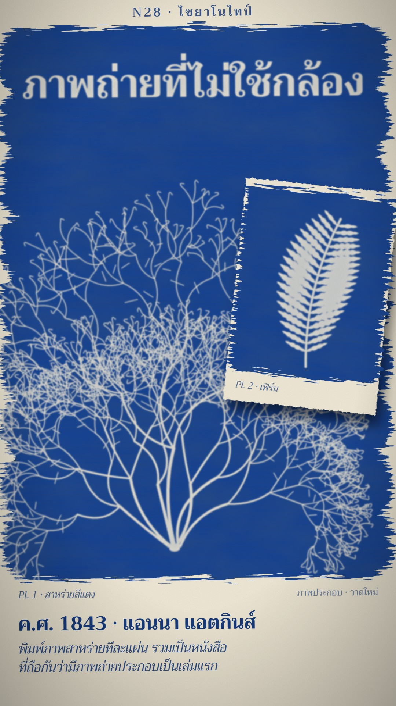

# N28 ไซยาโนไทป์ · Cyanotype Sun Print

**Fits:** inventions, botany, science history, "how it was first done" stories, one-object explainers ·
**Formats:** 9:16 · **Code:** `Demo.tsx` + `kit/Cyano.tsx`

## Look

The frame is a sheet of rag paper almost to the edges, brushed with a cyanotype coat: deep Prussian blue with
pooled darker blotches and bristle streaks, ragged brush ends where the coat runs out, a cream margin left round
it. Objects appear as **white photograms**: the shape of a real thing that lay on the sheet in the sun, crisp where
it touched the paper and soft where light crept under it (a faint blue halo). The title itself is "cut from paper"
and printed with the specimen, so it develops white with it. Notes sit in the paper margin in blue ink, a small
second sheet can slide over a corner. The world outside the paper is a dark slate drying table.

| Role | Hex |
|---|---|
| Background (slate table) | `#1d2125` |
| Main (washed Prussian blue) | `#17428f` |
| Second (rag paper, the white print) | `#efe8d6` |
| Accent (wet ferric sensitiser, before light) | `#d2cf86` |
| Text (blue ink on the margin) | `#163a7c` |

Also: exposed grey-bronze `#6e7782` (coat after sun, before the wash), pooled blue `#0d2a63`.

**Type:** Trirong (OFL) — title 104 px / 700 printed white in the coat; kicker 32 px / 600 letter-spaced; caption
50 px / 700 + 35 px italic in ink `#163a7c` in the bottom margin; plate notes 24–26 px italic. **Line:** no drawn
outlines. Shapes are silhouettes with a 1.6 px blur on the cut edge and a 9 px blurred halo at 18 % opacity.

## Motion signature — the print develops

1. **Brush on** (≈2.5 s): the sensitiser goes on in 9 horizontal bands, alternating direction, each band growing
   from one side; the band ends are ragged (displacement filter with fast noise across the stroke).
2. **Lay and expose** (≈3.5 s): the object drops onto the sheet with a soft shadow; warm raking sunlight; the coat
   turns from yellow-green to grey-bronze while the covered shape stays sensitiser yellow.
3. **Lift and wash** (≈3 s): the object lifts off; a waterline with a wet sheen travels down the sheet and above
   it the coat turns Prussian blue and the shaded shape turns paper white. This top-to-bottom develop is the
   style's reveal — use it for every new picture.
4. Between reveals: a slow push (≤ 5 %), a 6 px drift, a new sheet sliding in over a corner (whoosh).

## Scenes in the kit (`kit/Cyano.tsx`)

| Component | Shows | Props |
|---|---|---|
| `CyanoDefs` | Fibre, blotch, bristle, ragged-edge, deckle, halo and sun filters/gradients | — |
| `Sheet` | Rag paper on the table with deckled edge and cast shadow | `x, y, w, h, rot` |
| `Print` | The coat: sensitiser → exposed → washed from the waterline down, specimen cut white | `id, x, y, w, h, brush, sun, wash, specimen, specimenOn, lift` |
| `BrushMask` | The brushed coat shape (bands revealed by `k`) | `id, x, y, w, h, k` |
| `alga()` | Procedural branching seaweed → `Seg[]` for `<Strokes>` | `seed, x, y, len, ang, w` |
| `fern()` | Procedural fern frond with lobed pinnae | `x, y, len, ang, curl` |
| `Strokes` | Draws `Seg[]` (stroke colour from the parent group) | `segs` |
| `Sun` | Warm raking light during exposure | `k` |

A specimen is any SVG group that takes its colour from its parent (it is drawn black into the mask, brown as the
real object, blue in the halo). New subjects: leaves, feathers, lace, keys, a gear, a printed negative, cut-paper
letters — anything with a recognisable outline. Give each `Print` a unique `id` (mask ids).

## Build notes

One SVG at 1080×1920. The coat is two masks (`<id>-coat` = brush shape, `<id>-cut` = brush minus specimen) and two
clip paths split at the waterline. Filters on full-frame rects are the cost: keep at most 2 `Print`s on screen.
Procedural specimens are deterministic (`random(seed)`), so stills and renders match.

## Data

None. The demo's facts: Sir John Herschel described the cyanotype process in 1842; Anna Atkins issued
*Photographs of British Algae: Cyanotype Impressions* in parts from October 1843, generally regarded as the first
book illustrated with photographic images. Sources: Wikipedia "Cyanotype" and "Anna Atkins"; The New York Public
Library and the Getty Museum collection pages on Atkins' algae prints. The prints in the demo are drawn in code
("ภาพประกอบ · วาดใหม่"), not traced from her plates.

## Don'ts

- Not a blueprint: no grid paper, no technical white line drawings on blue, no nautical charts.
- No outlines, no colour other than the paper, the blues and the sensitiser yellow-green.
- Do not show the print fully developed from the first frame — the develop is the point.
- Do not copy real historical plates or their captions; draw new specimens.

## Credits

Everything drawn in code. Font: Trirong (SIL Open Font License). Sound: template `SFX.whoosh`, `SFX.swell`; house
library `wind` (bed) and `splash` (`npm run sfx-lib`).
