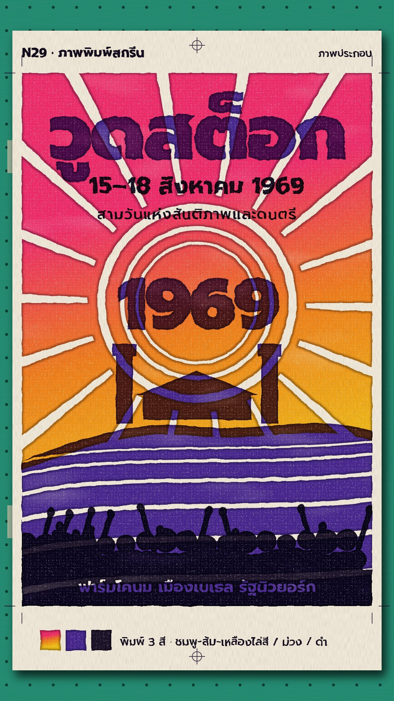

# N29 ภาพพิมพ์สกรีน · Screen-Print Poster

**Fits:** music, youth culture, protests, festivals and events, "one big number" facts · **Formats:** 9:16 ·
**Code:** `Demo.tsx` + `kit/Print.tsx`

## Look

A hand-pulled screen-print gig poster on an off-white sheet, lying on a green vacuum print bed (rows of suction
holes, registration stops). Two or three flat spot inks at most. The first ink is a **split fountain**: pink,
orange and yellow laid side by side on the screen and blended by the squeegee into one vertical gradient. Shapes
are hand-cut stencils: slightly wobbly edges, a darker **ink build-up along every edge**, pin-holes where the mesh
starved, an uneven lay-down, and a faint mesh weave over the whole printed area. Inks **overprint** (multiply):
violet over pink prints plum, violet over yellow prints olive, near-black over everything. Knock-outs (rays,
rings, furrows, lettering in the crowd) let the paper show through. Crop marks, a registration target, ink test
swatches and a pencil-style note in the margins.

| Role | Hex |
|---|---|
| Paper | `#f1eadb` |
| Fountain ink (pink → orange → yellow) | `#ff2f7d` → `#ff8a1e` → `#ffd21a` |
| Second ink (violet) | `#4b2aa8` |
| Key ink (near-black violet) | `#1d1430` |
| Print bed | `#1f8a6e` |

A second colourway for later sheets in a run: teal → lime → yellow fountain (`#11a7a0` → `#9ed43a` → `#ffd21a`).

**Type:** Prompt 900 for titles and the big number (hand-cut roughen filter `sp-cut`, tight letter-spacing),
Prompt 700/500 for dates and margin notes, all printed in one of the inks. Title 214 px, number 196 px, kicker
36 px at 1080 wide. **Line:** none drawn — edges come from the stencil cut and the ink build-up.

## Motion signature

- **The pull.** For each ink: the hinged screen drops onto the sheet (16 f, slight scale-down, wood thunk), the
  squeegee drags top → bottom (45–60 f, ease in-out) pushing a bead of that ink, the colour appears behind the
  blade, the screen lifts away (14 f). One ink per pull, never two.
- A finished sheet is pulled off the bed and racked (slides up and rotates out); the next sheet of the run is
  already on the bed with its first inks and gets one more pull — that is how a new fact arrives.
- Nothing else moves: no camera moves, no bouncing type. The print is still; only the tools move.

## Scenes in the kit (`kit/Print.tsx`)

| Component | Shows | Props |
|---|---|---|
| `PrintDefs` | Fountain gradients, paper, bed, ink and hand-cut filters, mesh pattern | — |
| `Bench` | Green vacuum bed with suction holes and registration stops | — |
| `Sheet` | The paper with shadow, fibre and mesh imprint; put inks inside | `x, y, rot` |
| `Ink` | One spot ink: roughened, edge build-up, pin-holes, multiply; revealed down to `upto` | `upto, opacity` |
| `Screen` | Aluminium frame and mesh, dropping on / lifting off | `down` 0–1 |
| `Squeegee` | Handle, blade and ink bead at the blade line | `y, ink, show` |
| `Marks` | Crop marks and registration targets in the margins | `color` |

`AREA` is the printed image area, `SHEET` the paper, `INK` the ink colours. Draw each ink's shapes in solid
colour (or `url(#sp-fountain)`) inside its own `<Ink>`; use `<mask>` for knock-outs.

## Build notes

One SVG at 1080×1920. The ink filter is per `<Ink>` group — keep to 3–4 inks per sheet. Keep the second sheet
hidden until the first is lifted (it is drawn under it). The squeegee position is `upto` for the ink being
pulled; other inks use the default (fully printed). Verified with stills only (frames 60, 150, 240, 300, 345,
420, 470); the clip was not rendered on this PC.

## Demo facts and sources

Woodstock Music and Art Fair, 15–18 August 1969, on Max Yasgur's dairy farm near Bethel, New York; billed as
"3 Days of Peace & Music"; 32 acts; attendance about 400,000 (an estimate, shown as "โดยประมาณ").
Sources: Encyclopaedia Britannica, "Woodstock" (festival); Wikipedia, "Woodstock". The poster art is original —
it does not copy the festival's own poster or logo.

## Don'ts

- Not risograph: no grainy misregistration as the look, no soft toner texture. Registration is tight; the
  texture is ink build-up and mesh.
- Not N07's litho poster: no tonal shading, no painted illustration — flat stencil shapes only.
- No more than three inks per sheet, plus paper. No gradients except the split fountain.
- No photos inside the print; a user photo would have to be posterised into one ink.

## Credits

None for pictures — everything is drawn in code. Sound: house library `city_crowd` bed, `wood_hit` and
`crowd_cheer` hits; template `SFX.whoosh` (`npm run sfx-lib`). Font: Prompt (SIL Open Font License).
