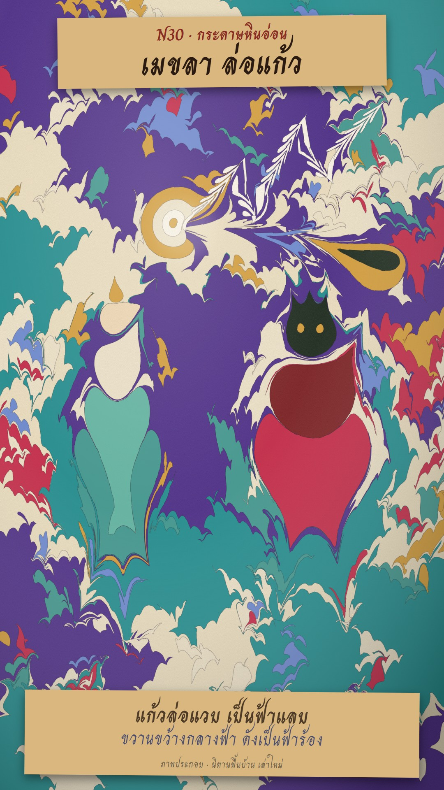

# N30 กระดาษหินอ่อน · Paper Marbling

**Fits:** myths, legends, dreams, folk tales, abstract ideas (how something "flows"), title sequences ·
**Formats:** 9:16 · **Code:** `Demo.tsx` + `kit/Marble.tsx` + `kit/Sim.ts`

## Look

Ebru-style paper marbling seen from straight above: the whole frame is the floating paint in the tray. Big drops
of violet and teal make the ground; a shower of small drops (ochre, crimson, cream, turquoise, sky blue) squeezes
the older colour into rings and stone shapes; combs drag it into feathered, wavy fields. Figures are made the
marbler's way — drops of colour pulled into shape by a stylus (a gown pulled down from a drop, crown points pulled
up from a head, a crystal of concentric rings). Every colour field meets the next with a thin dark vein. A soft
sheen lies over the size. Two kraft paper slips sit on top: the kicker and title, and the caption. At the end a
sheet of paper is laid on, lifted and turned over to show the print.

| Role | Hex |
|---|---|
| Size / paper | `#efe3c6` |
| Ground paints | violet `#4a2a8c`, teal `#1f8f94` |
| Accents | ochre `#d8a03a`, crimson `#c8284a`, turquoise `#3c9a94`, sky `#6a8ad8`, cream `#f1e7cf` |
| Figure darks | ink `#14261f`, wine `#7a1a22` |
| Labels / text | kraft `#d9b77e`, ink `#2a1a12` |

**Type:** Charm 700 (title 78 px, caption 52 px), Charm 400 for the second caption line in indigo, on kraft
slips. **Line:** no drawn lines — only the dark veins where colours meet (1.3 px, 28 % opacity).

## Motion signature

- **Drop:** each drop grows from nothing in 5–10 frames and pushes everything around it outward (true ink-drop
  displacement, not scaling); a faint ripple ring marks where it fell.
- **Comb:** the comb bar crosses the tray; alternate teeth push opposite ways → waves; a fine comb adds feathering.
- **Stylus:** the awl's tip draws a path and drags paint along it; this is how figures, points and the lightning
  are pulled. The surface only changes where the tools touch it — no camera moves.
- **Lift:** paper laid on (16 f), soaks (colour bleeds through), lifts and turns over (40 f) to show the print;
  the tray is left pale.

## Scenes in the kit

| Piece | Does | Notes |
|---|---|---|
| `kit/Sim.ts` `simulate(ops, frame)` | Runs the op list up to `frame` and returns the paint shapes | ops: `drop`, `tine`, `stroke` with `at`/`dur` frames |
| `MarbleDefs` | Grain, wood, paint-edge and sheen filters | once per SVG |
| `Surface` | Draws the shapes on the size inside a clip | `shapes, ground, clip, veins` |
| `Stylus`, `Comb` | The tools, drawn where the current op is | Demo shows how to place them |
| `Tray` | Wooden rim and sheen around a box | full-frame in the demo (rim off-canvas) |

Make a new picture by writing ops: ground drops first (r 200–240), accents (r 12–80), combs, then the figure
drops and the stylus strokes that shape them. Strokes: `z` 40–160 px, `lambda` 8–46 (small = a sharp point,
large = a broad pull).

## Build notes

The simulation is recomputed from the first op every frame (deterministic, ~0.3–0.8 s per frame for ~160 shapes,
~30 k vertices); keep under ~200 drops. After the last op the demo freezes the surface (`Math.min(frame, 469)`).
The paper flip is CSS 3D on an HTML layer above the SVG. Verified with stills only (frames 100–560); the clip
was not rendered on this PC.

## Demo story and source

The Thai folk tale of Mekhala (เมขลา), keeper of a magic crystal, and the giant Ramasura (รามสูร) who chases
her for it: the crystal's flash is lightning, his thrown axe is thunder. Retold in our own words, labelled
"นิทานพื้นบ้าน เล่าใหม่". Background: Thai Wikipedia, "เมขลา" and "รามสูร".

## Don'ts

- Not watercolour and not ink scroll: no washes, no bleeding edges, no brush marks — marbled paint has crisp
  edges and veins.
- No drawn outlines on figures; shape them from drops and stylus pulls.
- Don't move the camera or slide shapes around; only drops, combs and the stylus change the surface.
- Keep labels on paper slips; text never sits directly on the paint.

## Credits

None for pictures — everything is drawn in code (drop formula after the standard marbling math, e.g.
A. Jaffer's "Mathematical Marbling"). Sound: house library `rain_light` and `wind` beds, `thunder_rumble` and
`thunder_close` hits; template `SFX.pop`, `SFX.whoosh`, `SFX.swell`. Font: Charm (SIL Open Font License).
