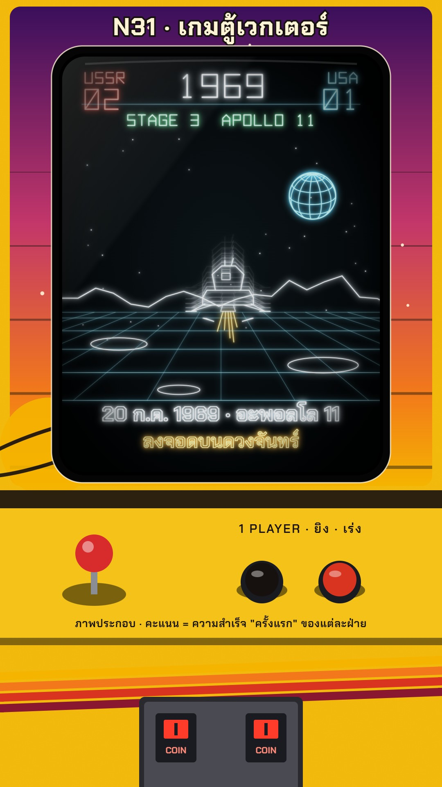

# N31 เกมตู้เวกเตอร์ · Vector Arcade Screen

**Fits:** space race, tech and science history, "firsts" and rivalries, games history, countdowns ·
**Formats:** 9:16 · **Code:** `Demo.tsx` + `kit/Vector.tsx`

## Look

A story played on a vector-display arcade cabinet, seen from where the player stands. The tube sits high in a
printed bezel (violet → magenta → orange sunset print, a ringed planet, stars; the kicker printed along its top
edge). On the tube, everything is a **thin glowing beam line on black**: wireframe globes with hidden back lines
dimmed, wireframe ships, a perspective ground grid, a score HUD in a stroke-only vector font. No fills, no pixels,
**no scanlines**. Moving objects leave **phosphor trails** (earlier positions fading). Curved glass: vignette, a
soft diagonal reflection, a bright rim. Below: a yellow enamel control panel with a red ball stick and two buttons,
cabinet stripes (gold, orange, red, maroon) and a coin door with lit coin slots.

| Role | Hex |
|---|---|
| Tube | `#020305` |
| Beam cyan / white | `#5fd8ff` / `#e8f7ff` |
| Side A / side B score | red `#ff5146` / cyan `#5fd8ff` |
| Accents (stage, captions) | green `#7dffb0`, amber `#ffc24a` |
| Cabinet | yellow `#f2b705`, stripes `#f5b400` `#f2781b` `#d8341f` `#8a1730`, bezel `#3a0f5c` → `#c2366a` → `#f2781b` |

**Type:** HUD and Latin labels in the kit's own vector stroke font (`VText`, 4×6 grid). Thai captions in
Chakra Petch 700/600 drawn **as outlines only** (stroke 2 px, no fill), glowing like the rest of the beam. Kicker
Chakra Petch 700, 60 px, cream with a dark outline on the bezel.

## Motion signature

- **Power-on:** a bright dot opens into a line, then into the picture (22 f).
- **Beam trace + phosphor:** ships move on orbits/trajectories with 6–14 fading copies behind them (`trail()`).
- Globes turn slowly (0.018 rad/f); the beam flickers ±5 %.
- Stage change: hit sound, the stage name blinks, the score digit changes. "INSERT COIN" blinks at the end.
- The camera never moves; the game cuts between screens (orbit view → surface view).

## Scenes in the kit (`kit/Vector.tsx`)

| Component | Shows | Props |
|---|---|---|
| `VectorDefs` | Glow filter, tube and bezel gradients, clips | — |
| `Cabinet` | Cabinet, printed bezel with kicker, glass, panel, coin door; put `<Beam>` inside | `kicker, marqueeFont, lit` |
| `Beam` | Everything drawn by the beam (glow + tube clip + scale into the cabinet) | `flicker` |
| `VText`, `vtextPath` | Vector-font text | `text, x, y, size, color, anchor` |
| `Sphere`, `globeLines`, `craterLines` | Wireframe globe / moon with hidden-line dimming | `cx, cy, r, rotY, tilt` |
| `Sputnik`, `Vostok`, `Lander` | Wireframe craft | `x, y, s, a` |
| `trail` | Phosphor persistence for any moving thing | `(frame, render, n, step, decay)` |

Draw the tube picture in `TUBE` coordinates (84…996 × 300…1488); `Beam` maps it into the cabinet.

## Build notes

One SVG; one glow filter on the whole beam group (don't filter per object). Keep trails to ≤ 14 copies.
Verified with stills only (frames 10, 120, 240, 330, 400, 480); the clip was not rendered on this PC.

## Demo facts and sources

- 4 Oct 1957: Sputnik 1 (USSR), the first artificial satellite.
- 12 Apr 1961: Yuri Gagarin, Vostok 1, the first human in space; one orbit, about 108 minutes.
- 20 Jul 1969: Apollo 11's lunar module lands; 21 Jul 1969 (UTC) Neil Armstrong is first to step on the Moon.
The "score" counts each side's firsts in these three events only, labelled "ภาพประกอบ". Sources: NASA history
pages for Sputnik, Apollo 11 mission overview; Encyclopaedia Britannica, "Yuri Gagarin", "Sputnik".

## Don'ts

- Not 8-bit pixel art: no pixels, blocks or sprites; not N11 neon tubes (no thick coloured neon, no stage).
- No scanlines, no raster CRT effects; vector screens draw lines only.
- No filled shapes on the tube (text included: outline only).
- Don't imitate a real game's screen, ships, logo or cabinet art.

## Credits

None for pictures — everything is drawn in code. Sound: house library `wind` bed (very low); template
`SFX.swell`, `SFX.pop` (satellite beeps), `SFX.whoosh`, `SFX.hit`, `SFX.riser`, `SFX.tick`. Font: Chakra Petch
(SIL Open Font License).
