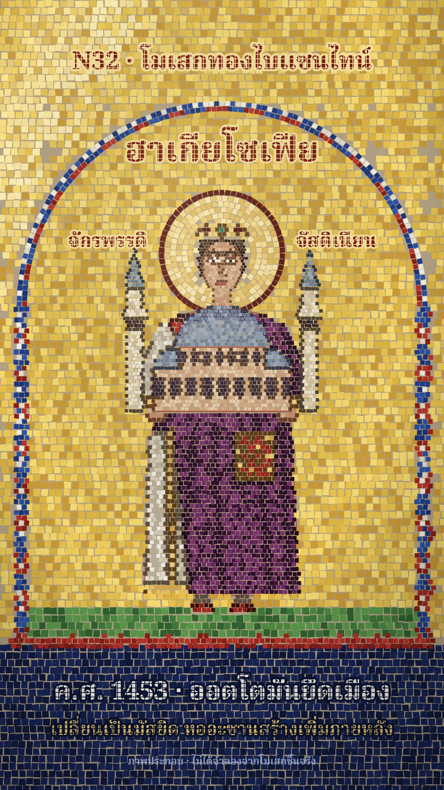

# N32 โมเสกทองไบแซนไทน์ · Byzantine Gold Mosaic

**Fits:** empires, emperors and dynasties, religion and great buildings, medieval history, "what changed over
centuries" stories · **Formats:** 9:16 · **Code:** `Demo.tsx` + `kit/Mosaic.tsx`

## Look

A wall mosaic in the Byzantine icon manner. A shimmering **gold-tile ground** fills the wall; a round **arch**
edged with a jewelled band (red and blue segments, a row of white pearls) frames one frontal figure: large
halo set in concentric rings with a red rim, stylised drapery in dark-lined folds, big almond eyes, crown with
pearl pendants, standing on a strip of green. Every tessera is a slightly irregular quad with its own tilt and
shade, with mortar showing between; the gold ground is laid in straight rows, the halo and arch in rings
(andamento follows the curve), figures in fine tiles, faces finer still. Tiles on a border take a dark outline
colour, which draws the contours. Inscriptions are letters set in tesserae (red on gold); the caption sits on a
lapis-blue band. Missing tiles reveal the beige mortar bed and the red underdrawing (sinopia).

| Role | Hex |
|---|---|
| Gold ground | `#f0cc5c` `#e6c24c` `#f6da70` `#dcb440` `#c99a35` |
| Lapis band | `#121d47` – `#1a2858` |
| Imperial purple | `#7a3069` → `#2a0c26` |
| Red (band, halo rim, shoes) | `#a3261d` |
| Pearl / text | `#f6f1e6` |
| Mortar / sinopia | `#c9b796` / `#a5452c` |

**Type:** Noto Serif Thai 800 (title 84 px, caption 62 px) and 600 (second line 44 px), cut by a tile mask with
a solid outline row, so the letters read as tesserae. Small honesty label unmasked. **Line:** tesserae only — no
drawn strokes; contours are rows of dark tiles.

## Motion signature

- **Tile-set:** tesserae are pressed in one by one in sweeps (ground from the halo outward, figure from the feet
  up, face last): each tile arrives slightly larger and lighter and settles in 8 frames.
- **Shimmer:** a light band crosses the wall continuously; each gold tile flashes when it passes, at a
  different moment for its tilt.
- **Fall-out:** a part that is destroyed loses its tiles — they drop, tumble and fade, leaving mortar and the red
  underdrawing; the rebuilt part is set again tile by tile.
- No camera moves except a short shake on a disaster.

## Scenes in the kit (`kit/Mosaic.tsx`)

| Piece | Does | Notes |
|---|---|---|
| `rows`, `rings`, `fine` | Lay tiles over a `paint(x, y)` picture function | straight rows / concentric / fine grid |
| `inPoly`, `inEll`, `distLine` | Build the picture function from polygons, ellipses and fold lines | |
| `TileEl` | One tile, setting in (`k`), glinting (`glow`) or falling (`fall`) | |
| `glint` | Shimmer amount for a tile at a light-band position | |
| `MosaicDefs` | Mortar grain, tile mask for lettering, light gradient | |

Build tiles once at module level (the demo builds ~14 k); per frame only timing and glints are computed.
Give each layer that must change on its own (a dome, towers) its own paint function and tile list.

## Build notes

One SVG at 1080×1920. ~14 k paths render in about 2–3 s per still. Keep faces at 7 px tiles, figures 11 px,
ground 18 px. Verified with stills only (frames 90, 120, 200, 255, 262, 360, 470); the clip was not rendered on
this PC.

## Demo facts and sources

Hagia Sophia, Constantinople: built under Emperor Justinian I, dedicated 27 December 537; the main dome collapsed
after earthquakes in 558; rebuilt with a dome about 6 m higher, re-dedicated 562; after the Ottoman conquest in
1453 it became a mosque, and minarets were added in the following decades and centuries. Sources: Encyclopaedia
Britannica, "Hagia Sophia"; Wikipedia, "Hagia Sophia". The mosaic is an original composition (labelled
"ภาพประกอบ · ไม่ได้จำลองจากโมเสกชิ้นจริง"), not a copy of any surviving mosaic.

## Don'ts

- Not M25's stone floor mosaic (no map, no muted stone colours) and not N25's Thai glass mosaic: the ground is
  gold and the composition is a frontal icon in an arch.
- No smooth gradients or drawn outlines on figures; everything is tiles.
- No three-quarter poses, no perspective scenes; figures are frontal and still, the motion is in the tiles.
- Don't copy a real mosaic (Ravenna, Hagia Sophia's own panels); compose new ones.

## Credits

None for pictures — everything is drawn in code. Sound: house library `wind` bed, `church_bell`,
`thunder_rumble`, `wood_break` and `gong` hits; template `SFX.swell`, `SFX.tick`. Font: Noto Serif Thai (SIL
Open Font License).
