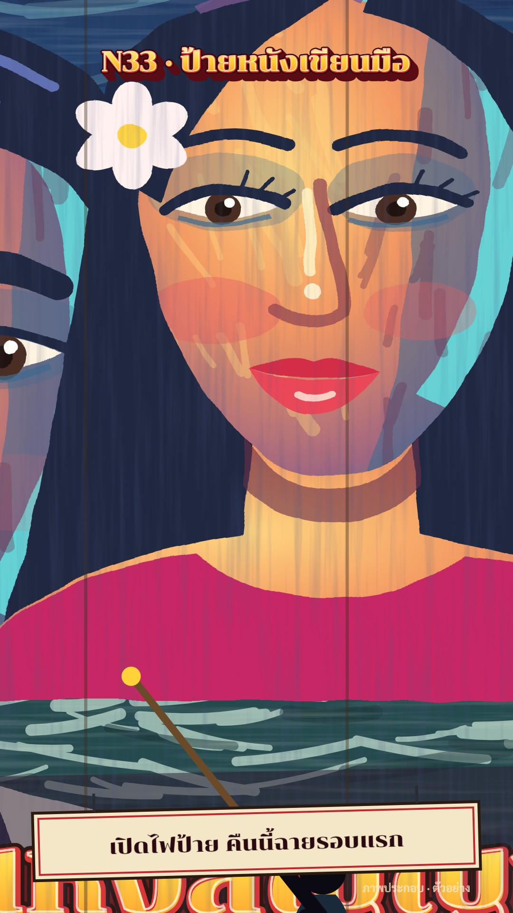

# N33 ป้ายหนังเขียนมือ · Hand-painted Cinema Billboard

**Fits:** drama, famous people (as painted portraits of *original* characters or of people the channel may show),
nostalgia, "the old cinema in town", film history, a story told as a film poster · **Formats:** 9:16 ·
**Code:** `Demo.tsx` + `kit/Billboard.tsx`

## Look

A big cinema billboard painted by hand on plywood boards, mounted on a steel scaffold over a street at dusk. The
board starts primed cream with a pencil squaring grid (A, B, C… along the top) and is painted in visible brush
strokes: a moonlit harbour sky in blues and teals, then two giant faces built from flat oil-paint planes — warm
orange light side, cool blue shadow side, a cyan rim light on the shadow edge, white-yellow dabs on nose, eyes and
lips — then a hand-lettered title in a stacked 3D block (dark red drop, red outline, yellow-to-orange face, white
highlight stroke). Board seams show through the paint. A red marquee strip with bulbs runs on top, a working
plank, a bamboo ladder and a small painter with a long brush sit below; at nightfall the bulbs chase, floodlights
hit the board and a queue gathers in the warm glow of the cinema doors. Captions are on a hand-painted signboard
hung from the scaffold.

| Role | Hex |
|---|---|
| Night sky / background | `#0a0f22` (dusk `#1d2f4f` → `#d9785a`) |
| Skin light → mid → shadow | `#ffd27a` → `#f2905a` → `#2e5f8a`, rim `#58e2e6` |
| Painted sky (board) | `#0b1f4a` → `#1d5a9a` → `#3fa3c0` → `#ffd88a` |
| Title paint | `#fff6b0` → `#ffd23a` → `#ff8a1c`, outline `#d7262b` |
| Marquee red / bulbs | `#9e1420` / `#fff0a8` |
| Caption board text | `#2a0a10` on `#f4e7c8` |

**Type:** Chonburi 400 for everything painted (kicker 58 px and title 104 px as `Lettering`, marquee 46 px,
caption 44 px); Sarabun 600/800 only for the small honesty labels. **Line:** brush — no vector outlines on the
painting except the dark hair masses and brows painted as thick strokes; edges wobble (`bb-oil` displacement).

## Motion signature (`brush-in`)

- Every painted layer appears through `PaintIn`: rows of thick zig-zag brush strokes drawn in order with a dash,
  ragged bristle edges from `bb-bristle`. Order: background (rows tilted −8°), face 1 (+70°, top-down), face 2
  (−70°), title (horizontal, left to right). One whoosh per few strokes.
- The pencil grid fades as the paint covers it; the painter slides along the plank under the part being painted,
  arm swinging, brush tip in the current colour.
- Lights on: sky darkens, marquee bulbs switch on in a left-to-right chase (then a 3-step chase loop),
  floodlights snap on with a hit, the queue fades in.
- Final move: the camera walks up to the board (zoom ×2.15 in 56 frames) until one painted face fills the frame;
  the kicker and the caption board stay put. Slow push (+4.5 %) before that.

## Scenes in the kit (`kit/Billboard.tsx`)

| Component | Shows | Props |
|---|---|---|
| `BillboardDefs` | bristle/oil/streak filters, sunset & title gradients, cone | — |
| `Sky` | dusk → night sky with stars | `night` 0–1 |
| `PaintIn` | brush-stroke reveal of its children | `id, p, x, y, w, h, sw, angle, seed` |
| `Strokes` | loose brush hatching inside painted areas | box, `n, color, sw, len, angle` |
| `Face` | giant painted face of an original character | `x, y, s, turn, kind, look, id` |
| `Lettering` | hand-lettered 3D title paint | `x, y, size, text, font` |
| `Grid` | pencil squaring grid on the primed board | box, `opacity` |
| `Scaffold`, `Ladder`, `Painter` | the steel scaffold, bamboo ladder, the painter | `top, dark` / `x, reach, t` |
| `Bulbs`, `Floods`, `Street` | marquee bulbs chase, floodlight cones, queue + door glow | `on, t` / `night` |

New story: change the faces (`kind`, `turn`, `look`, hair), the painted background inside the first `PaintIn` and
the title. Keep the order background → faces → title, and keep the scaffold and painter: they are what makes it a
billboard and not a poster.

## Build notes

One SVG 1080×1920; the camera group holds board + scaffold, the kicker and caption board are drawn after it.
`PaintIn` returns plain children once `p ≥ 1`, so a finished board costs no masks. Keep `Strokes` counts under
~80 per area. The cover is frame 534 (close-up after the camera move); frame ~474 is the full billboard at night
and works as an alternative still.

## Data

None. The demo is a generic example: a made-up film ("ท่าเรือแห่งสัญญา") with made-up actor names, labelled
"หนังสมมติ" on the board and "ภาพประกอบ · ตัวอย่าง" on screen. The captions only describe the painting process
(squaring a small poster up with a grid, painting by brush, hand lettering, lighting the board), which is how
hand-painted cinema boards were generally made; no dated or named claims are made.

## Don'ts

- Never paint a real actor's face or a real film's title/poster; for real people, use the channel's own photo
  through a `photo?` prop slot or paint an obviously original character.
- Not tin signs (M12) and not screen print (N29): no flat registered ink layers, no halftone, no rivets — this is
  wet brushwork with highlights and rim light.
- Don't skip the scaffold/painter/bulbs; without them it reads as a generic poster.
- Don't let the brush reveal run faster than ~8 strokes a second; it should look painted, not wiped.

## Credits

Everything drawn in code. Sound: template `SFX.whoosh`, `tick`, `hit`, `swell`; house library bed `city_crowd`.
Fonts: Chonburi, Sarabun (SIL Open Font License).
