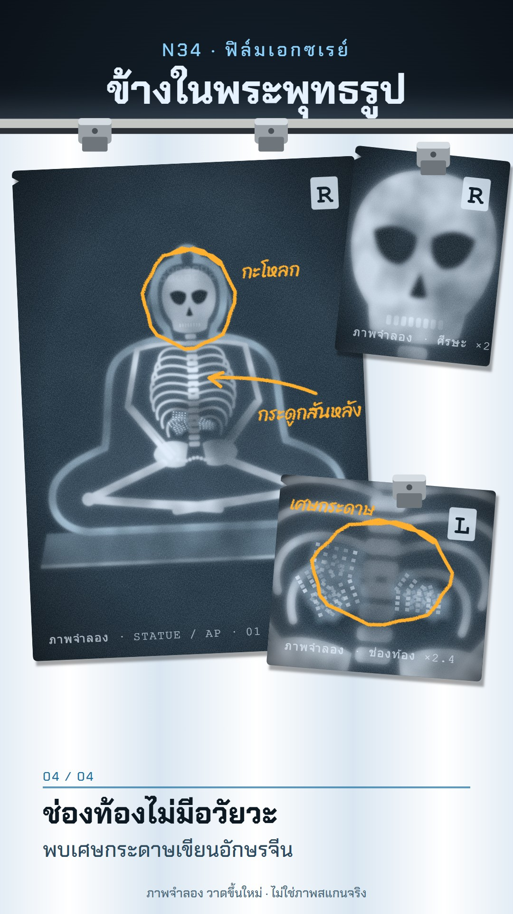

# N34 ฟิล์มเอกซเรย์ · X-ray Film on a Light Box

**Fits:** what is inside things — artefacts, statues, mummies, sealed boxes, swords, instruments, the body and
medicine, museum "scan reveals…" mysteries · **Formats:** 9:16 · **Code:** `Demo.tsx` + `kit/XRay.tsx`

## Look

Radiograph films clipped to a wall light box in a dark reading room. The light panel is cool white with soft
vertical tube banding and fills the frame from the clips down to the bottom edge, bleeding off both sides; only a
dark wall strip with the title is above it. Films are dark blue-grey sheets with rounded corners, a corner notch,
grain, mottled density and fogged edges; dense material glows blue-white with a soft halo (bone, metal, thick
walls), thin material is a faint grey-blue. Each film carries a lead side marker (R/L) and a burned-in imprint
line starting with "ภาพจำลอง". Spring clips hold the films. The radiologist's orange wax-pencil marks (rings,
arrows, handwritten notes) are drawn on over the film. Captions are printed in dark ink on the lit panel below the
films: an index (01 / 04), a bold line and a lighter sub-line.

| Role | Hex |
|---|---|
| Wall | `#0a0f15` (lit centre `#1a2a38`) |
| Light panel | `#eef5fb` / tubes `#ffffff`, `#d9e6f1` |
| Film base | `#13212c` (+ `#30495c` light through) |
| Dense / soft | `#e6f2ff` / `#5e7d94` |
| Wax pencil | `#ffb02e` |
| Caption ink | `#0c1822`, index `#1d6fa0` |

**Type:** Chakra Petch 700 (title 84 px, caption 62 px) and 500 (kicker 38 px spaced 6, sub-line 44 px, imprint
24 px); Sriracha for the wax-pencil notes (36–38 px). **Line:** glow — no outlines; every shape is density with a
blurred halo (`Radio`).

## Motion signature (`slide-clip`)

- The light box flickers on like a fluorescent tube (`tubeFlicker`, ticks on each flash).
- Films slide in under the clips with a small overshoot (`Easing.back`), the clip snaps closed (rotates 14° → 0)
  with a pop. Main film from the top, a head film from the top, a detail film from the right.
- "Window" reveal: the inside (here the skeleton) fades up from 0 while the shell is already visible — the moment
  the scan shows what the object hides.
- Wax pencil draws itself (dash offset), note text fades in after the stroke; slow push +3.5 %.

## Scenes in the kit (`kit/XRay.tsx`)

| Component | Shows | Props |
|---|---|---|
| `XRayDefs` | halo/soft/grain/mottle/wax filters, tube gradient | — |
| `LightBox` | housing, light panel, pilot light; children on the panel | `x, y, w, h, on` |
| `tubeFlicker(f)` | start-up flicker 0/1 | frames since switch-on |
| `Film` | film sheet with base, grain, fog, notch, marker, imprint | `x, y, w, h, rot, lit, id, label, side` |
| `Radio` | turns any shapes into radiograph density | `core, strength` |
| `StatueShell`, `Skeleton`, `Scraps` | seated statue wall, seated skeleton, paper scraps | `k` |
| `Grease` | wax-pencil ring / arrow / note | `p, ring, arrow, note, nx, ny, font` |
| `Clip` | spring clip | `x, y, snap` |

New object: draw its outer wall as a `StatueShell`-like path (low-density fill + `Radio` stroke) and its inside
as bright shapes in `Radio`; zoomed detail films reuse the same component inside a scaled group.

## Build notes

One SVG at 1080×1920. Films are clipped to the panel; each `Film` gets a unique `id`. Up to three films on the box
reads well; more gets cluttered. The cover is frame 492 (all three films, both wax marks, last caption). The panel
bleeds off the frame on purpose — don't shrink it back into a framed box.

## Demo story and sources

In 2014 a Chinese Buddha statue (believed about 1,000 years old) was CT-scanned and examined by endoscopy at the
Meander Medical Center in Amersfoort, the Netherlands, for the Drents Museum; inside it was the mummified body of
a seated monk, believed to be the Buddhist master Liuquan, who died around 1100 CE. The organs had been removed
and scraps of paper printed with Chinese characters were found in the body cavity. Results were published in
February 2015. Sources: Drents Museum / Meander Medisch Centrum announcement (Feb 2015); reports in Smithsonian
Magazine, The Guardian and other outlets (Feb–Mar 2015). (The statue
was later claimed by villagers of Yangchun, Fujian, in a Dutch court case.) The pictures are a drawn
reconstruction, labelled "ภาพจำลอง วาดขึ้นใหม่ · ไม่ใช่ภาพสแกนจริง"; positions and sizes are not measured.

## Don'ts

- Not cyanotype (N28): no Prussian-blue print on paper, no white botanical silhouettes — this is a backlit film.
- Not recon film (M04): no aerial photo strips or map grids.
- Never present the drawing as the real scan; keep the imprint and footer labels. No real patient data, names or
  hospital logos on films.
- No red/green "UI" overlays; annotations are wax pencil only.

## Credits

Everything drawn in code. Sound: template `SFX.tick`, `whoosh`, `pop`, `riser`, `hit`; house library bed `wind`
(room tone, very low). Fonts: Chakra Petch, Sriracha (SIL Open Font License).
