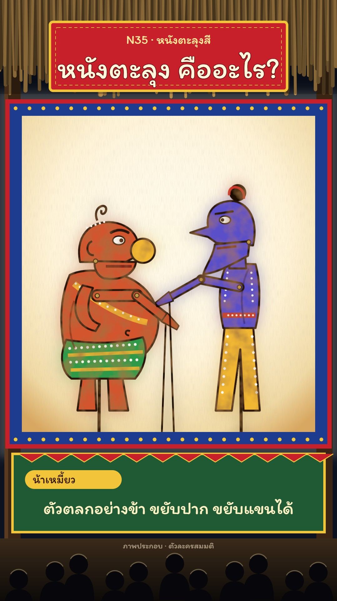

# N35 หนังตะลุงสี · Colour Nang Talung Shadow Puppets

**Fits:** southern Thai tales, comedy, satire, two characters arguing a point, explaining something in a
friendly local voice, festivals and night fairs · **Formats:** 9:16 · **Code:** `Demo.tsx` + `kit/Talung.tsx`

## Look

A small performance hut at night: a thatch fringe across the top with a red signboard (kicker + title), dark
wooden posts, and in the middle a white cloth screen lit from behind by a lamp — warm white at the hot spot,
cream to amber at the edges, a fine weave. The screen has a blue cloth border with a red trim and rows of gold
dots. On it, small **translucent dyed-hide puppets** in strong colours (orange-red, green, yellow, violet-blue):
each fill is multiplied onto the screen so the lamp shows through, with mottled hide density, a soft coloured light
bleed around the shape, a dark brown outline, and punched holes that let pure light through. Every puppet has a
dark main rod running down out of the screen and a thin rod to its moving hand; the comic puppets have pinned
joints (gold rivets), a hinged jaw and one articulated arm. Below the screen a green fascia board carries the
caption (a yellow speaker chip + the line); the audience sits on mats in silhouette, rim-lit by the screen.

| Role | Hex |
|---|---|
| Night / outside | `#0c1220` |
| Screen centre → edge | `#ffffff` → `#fff3d6` → `#f0d9a4` → `#d9a860` |
| Border / trim / dots | `#1d3b8f` / `#c8202a` / `#f2c43a` |
| Puppet colours | `#d2552e`, `#2f9a4a`, `#f2b731`, `#5a4fc8`, `#d0342c` |
| Hide outline | `#2a140a` |
| Caption text / fascia | `#fff2c4` / `#1f5a34` |

**Type:** Itim 400 everywhere (title 96 px, caption 56 px, speaker chip 38 px, kicker 40 px). **Line:** carved —
4.5 px dark outlines and rows of punched holes (radius 2.4–3.4 px), no gradients on the puppets.

## Motion signature (`rod-jerk`)

- Puppets move like hide on rods: hop-walks (|sin| bob), whole-body tilts, never smooth 3D turns.
- Talking = the hinged jaw flaps in syllable rhythm (`talk()`), while the rod arm swings from pinned joints.
- Focus pull: a puppet entering from far behind the cloth is big, soft and pale (`Depth away=1`) and sharpens as
  it is pressed onto the screen (`away → 0`).
- The tree puppet twirls on its rod (x-scale = cos of the spin) to open the show and as a scene wipe.
- The lamp flickers slightly all the time (`lampAt`); a gong hit marks the opening.

## Scenes in the kit (`kit/Talung.tsx`)

| Component | Shows | Props |
|---|---|---|
| `TalungDefs` | screen and lamp gradients, weave, hide texture, light bleed | — |
| `Hut` | night, posts, border, lit screen, thatch + signboard | `x, y, w, h, lamp, sign` |
| `Depth` | one puppet: position, facing, distance blur, colour bleed | `x, y, s, face, away, rot, id` |
| `Clown` | comic puppet ("fat" or "thin"), jaw + rod arm | `kind, skin, cloth, accent, jaw, arm, t` |
| `TreePuppet` | forest/tree puppet, twirled on its rod | `spin` (turns) |
| `Holes` | punched-hole rows for new puppets | points, `n, r` |
| `lampAt(f)` | lamp flicker 0.85–1 | frame |

New puppets: draw them in profile facing right, one filled path per part with `{...O}` outline, holes along
clothing and crowns, pinned joints as small gold circles, a rod from the body down to y = 900.

## Build notes

One SVG at 1080×1920; puppets are clipped to the screen and use CSS `mixBlendMode: multiply`. Each `Depth` draws
its children twice (bleed + sharp), so keep to ~4 puppets on screen. The cover is frame 352 (both clowns, the thin
one talking).

## Demo facts and sources

Nang talung is the shadow-puppet theatre of southern Thailand; a single puppet master (นายหนัง) works the puppets
and speaks all the voices; comic puppets have movable jaws and arms; the name is commonly said to come from
Phatthalung province ("เชื่อกันว่า" on screen). Sources: สารานุกรมไทยสำหรับเยาวชนฯ entry หนังตะลุง; Department
of Cultural Promotion, intangible cultural heritage register (หนังตะลุง, 2009); Wikipedia "Nang talung". The two
clowns ("ลุงหมอก", "น้าเหมี้ยว") are original characters, not the traditional named clowns; labelled
"ภาพประกอบ · ตัวละครสมมติ".

## Don'ts

- Not nang yai (N05): no big black carved panels on amber cloth, no performers dancing in front of the screen —
  small, colourful, translucent puppets on a white screen.
- Don't copy the traditional named clown puppets or a real troupe's puppets or name; design new ones.
- Don't mock southern speech or people; the comedy is in the characters, not the dialect.
- No smooth tweened rotation of a puppet in 3D; hops, tilts and jaw/arm moves only.

## Credits

Everything drawn in code. Sound: house library `gong` (Hit), `crowd_cheer`, bed `city_crowd`; template
`SFX.whoosh`. Font: Itim (SIL Open Font License).
