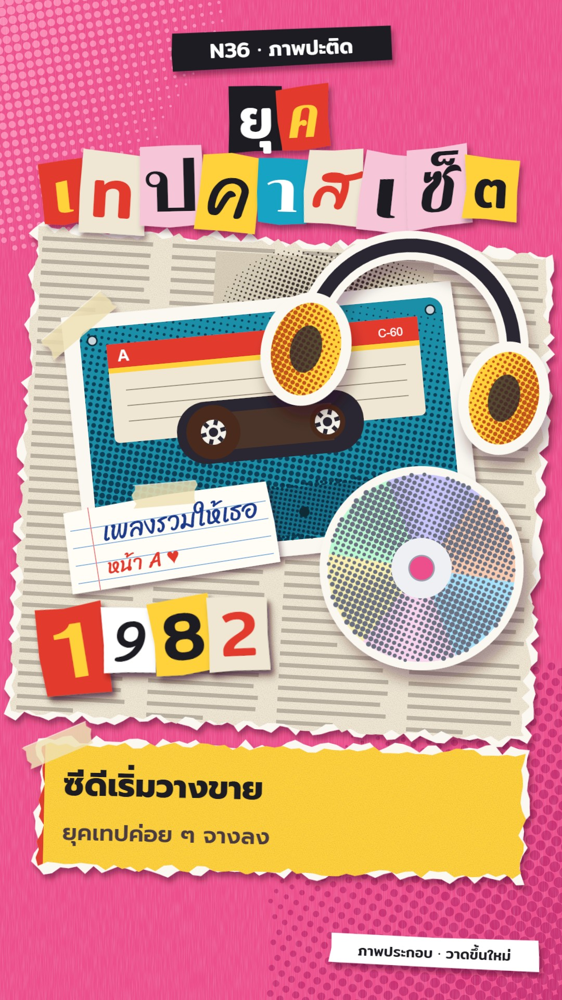

# N36 ภาพปะติด · Magazine Cut-out Collage

**Fits:** pop history, eras and trends, music, fashion, gadgets, "the year everything changed", timelines of
consumer things · **Formats:** 9:16 · **Code:** `Demo.tsx` + `kit/Collage.tsx`

## Look

Paper pieces cut from imaginary magazines and stuck on a hot-pink sheet. The base sheet has paper fibres and two
big printed dot screens in the corners. A large torn newsprint sheet (grey text columns, a halftone picture
block) sits behind everything at an angle. Objects are scissor-cut with a white margin, as if cut out of a page,
and printed with halftone dots (the cassette, headphones and disc are drawn in code — no photos). Torn pieces show
a white paper core along the ragged edge. Masking tape holds the corners; every piece casts a soft "glue" shadow
and a bigger one while it is lifted. Titles are ransom-note letters: each Thai cluster on its own cut scrap, each in
a different font, colour pair and tilt. Captions are torn yellow or cream strips with a red edge, taped down.

| Role | Hex |
|---|---|
| Base sheet | `#ec4f8c` (dots `#c93273`, `#f98ab4`) |
| Newsprint | `#efe7d3`, text lines `#8f877a` |
| Print cyan / yellow / red | `#16a3c4` / `#ffd23a` / `#e23b2e` |
| Tape | `#efe0b4` at 82 % |
| Ink / text | `#1b1a22` |

**Type:** ransom letters mix Pattaya, Chonburi, Mitr, Sriracha, Fahkwang and Prompt (title 96–118 px, years
128 px); captions Prompt 800 (62 px) + 600 (44 px); kicker and labels Mitr 500. Main type token: Pattaya 400.
**Line:** torn-edge — ragged torn edges with white core, plus straight scissor snips; no drawn outlines.

## Motion signature (`stepped-on-twos`)

- Everything moves on twos (positions update every 2 frames) and pieces "boil" ±1 px / ±0.3° every 2 frames
  after landing, like re-shot paper.
- A piece slides in from off-frame along a short ease-out, lifted (big shadow), slaps down (3.5 % scale for 4
  frames, pop sound) and settles to the small glue shadow.
- Ransom letters land one by one, 4 frames apart, alternately from left and right.
- Per beat: the year digits and the caption strip are pulled off and new ones slapped down; one new cut-out
  object joins the pile (they stay, so the collage builds up). Reels and the disc turn on twos.

## Scenes in the kit (`kit/Collage.tsx`)

| Component | Shows | Props |
|---|---|---|
| `CollageDefs` | glue/lift shadows, fibre and grain, dot patterns | — |
| `Piece` | stop-motion placement of any children | `frame, at, dur, dx, dy, x, y, rot, seed, out, lift` |
| `TornPaper`, `torn()`, `cut()` | torn sheet with white core; torn / scissor-cut paths | box, `seed, fill, amp` |
| `Halftone` | halftone dots sized by a function | box, `step, fn(u,v), color, angle` |
| `Tape` | masking tape strip | `x, y, w, rot, seed` |
| `Ransom` | ransom-note title from Thai grapheme clusters | `text, x, y, size, fonts, seed, frame, at` |
| `Cassette`, `Headphones`, `Disc` | generic cut-out objects (no brands) | `spin` |
| `Newsprint` | grey text columns for background sheets | box, `seed` |

New era: draw the objects of that era like `Cassette` — a `cut()` white margin, flat print colours, `Halftone`
shading clipped to the shape — and keep the year + torn caption pair per beat.

## Build notes

One SVG at 1080×1920. `Halftone` makes one circle per dot: keep steps ≥ 9 px and boxes moderate (each piece < ~2,000
dots). `Ransom` uses `Intl.Segmenter("th")` so vowels and tone marks stay with their consonant. The cover is frame
486 (cassette, headphones, mixtape label, disc, "1982").

## Demo facts and sources

- 1963: Philips introduced the Compact Cassette at the Berlin radio show (Funkausstellung), August 1963.
- 1979: Sony's first Walkman (TPS-L2) went on sale in Japan on 1 July 1979, making music portable on the move.
  (Name used as a fact in text; no logo or product likeness is drawn — the headphones are generic.)
- 1980s: home-recorded compilation tapes ("mixtapes") were a common gift — a general trend, no number claimed.
- 1982: the Compact Disc went on sale in Japan on 1 October 1982; cassettes slowly gave way over the following
  decades.

Sources: Wikipedia "Cassette tape", "Walkman", "Compact disc"; Philips company history pages; Sony corporate
history ("Walkman" 1979). On screen: "ภาพประกอบ · วาดขึ้นใหม่".

## Don'ts

- Not pop-art comic: no Ben-Day comic panels, speech balloons, bold black outlines or "POW" lettering.
- No real photos, real magazine mastheads, brand logos or recognisable product designs; draw generic objects.
- Don't move smoothly on ones — the stepped, boiling motion is the style.
- Keep ransom titles short (≤ 10 clusters per row); long sentences go on the torn caption strip.

## Credits

Everything drawn in code. Sound: template `SFX.pop`, `whoosh`; house library bed `city_crowd` (very low). Fonts:
Pattaya, Chonburi, Mitr, Sriracha, Fahkwang, Prompt (SIL Open Font License).
